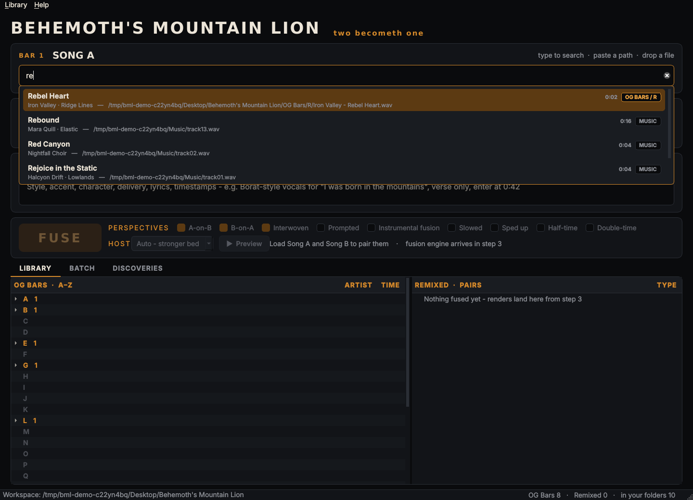
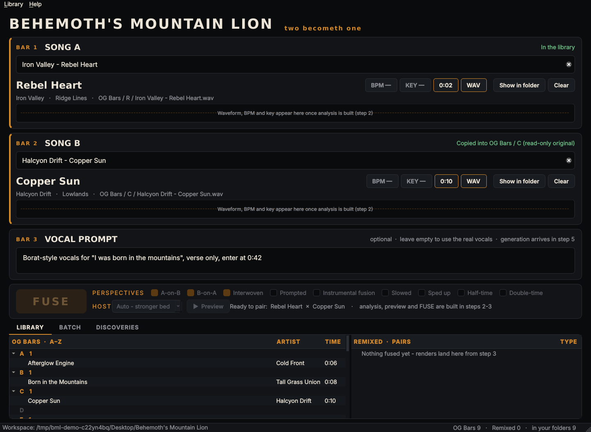

# Behemoth's Mountain Lion

A Windows desktop app that fuses two songs into one: the voice of one song performed inside
the body of the other, with an optional typed vocal direction (Bar 3). Free and local: no
paid APIs, no cloud. Built from [`prompts/claude/behemoths-mountain-lion.md`](../../prompts/claude/behemoths-mountain-lion.md).

## Build order and status

| Step | What | Status |
|---|---|---|
| 1 | Desktop folder structure, `Library.db`, A–Z filing, live search bars | **Done** |
| 2 | Analysis (BPM / key / sections), stem separation, waveforms | Next |
| 3 | Fusion engine: one perspective end to end into `Remixed/` | |
| 4 | All perspectives, `recipe.json`, second-pass remixing | |
| 5 | Bar 3 prompted vocals in the pipeline | |
| 6 | Batch mode, resumable queue | |
| 7 | Scout agent, pluggable engine adapters, Discoveries panel | |
| 8 | Single Windows installer | |

## Run it (step 1)

Windows, with Python 3.11+ from python.org: double-click **`run.bat`**. The first run makes a
`.venv` and installs PySide6 and mutagen. Or by hand:

```
python -m pip install -r requirements.txt
python -m bml
```

Tests: `python -m pytest` (the UI tests run headless).

## What step 1 does

**The workspace.** On first run the app creates and owns this on your Desktop (found through
the Windows shell, so a OneDrive-redirected Desktop works):

```
Desktop/Behemoth's Mountain Lion/
    OG Bars/        A/ … Z/  and  #/  (titles starting with a digit or symbol)
    Remixed/        fused pairs land here (step 3+)
    Stems/          cached stems (step 2+)
    Library.db      SQLite index: songs, folder files, analysis, renders
```

See [`docs/workspace-tree-example.txt`](docs/workspace-tree-example.txt) for a filled-in example.

**A one-time notice** on first run: only process audio you own or have rights to; everything
stays on this machine.

**Bar 1 and Bar 2** behave the same:

- **Type** to search. Results update as you type (every word is a prefix, accents ignored)
  across OG Bars, Remixed, and your library folders (Music and Downloads by default; add more
  from *Library → Add music folder…*). Songs already in OG Bars are badged with their letter.
- **Paste a path** (Windows "Copy as path" quotes are fine) and press Enter, or paste a folder
  path to add it to the library.
- **Drag a file** onto the bar. Dropping a folder adds it to the library folders.

Loading a song files it into **OG Bars**:

- copied to `OG Bars/<Letter>/<Artist> - <Title>.<ext>`, verified against the original by
  SHA-256, then marked **read-only**. The source file is never touched.
- **auto-tagged** from embedded tags (ID3, MP4, FLAC, Ogg…), or from a cleaned-up file name
  when there are none (`785b22e4-artist-song-official-visualizer-ytmp4.savetube.vip_copy.mp4`
  becomes `Artist Song`).
- **deduped** by content: the same audio under any name or folder is filed once. Different
  audio with the same title becomes `Title (2)`.
- a file dragged in from `Remixed/` is indexed in place as a second-pass source, not copied.

Files you drop into the workspace by hand are indexed on the next start, and songs whose file
went missing are flagged red in the library tree.

**The library browser** shows the OG Bars A–Z tree and the Remixed tree side by side.
Double-click a song to load it into Bar 1; right-click for Bar 2 or *Show in folder*.

**Bar 3, the FUSE row, Batch and Discoveries** are laid out but not wired yet; each says which
step brings it to life. BPM / key badges and the waveform strip fill in at step 2.

## Layout

```
bml/
    paths.py       Desktop / Music / Downloads lookup (Windows known folders)
    workspace.py   the Desktop folder tree
    filing.py      A–Z letter rules, Windows-safe names, media types
    tags.py        tag reading + file-name cleanup
    library.py     Library.db: import / dedupe / filing, folder scans, live search (SQLite FTS5)
    ui/            PySide6 window, bars, library browser, theme
tests/             core + headless UI tests
tools/snapshot.py  renders the screenshots in docs/screenshots from a demo library
```



