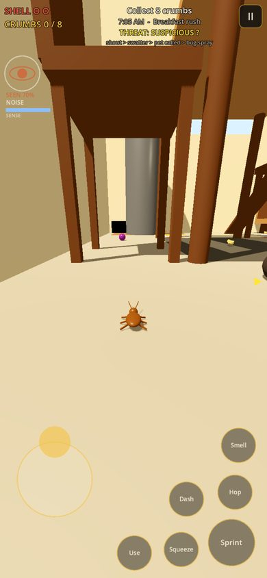
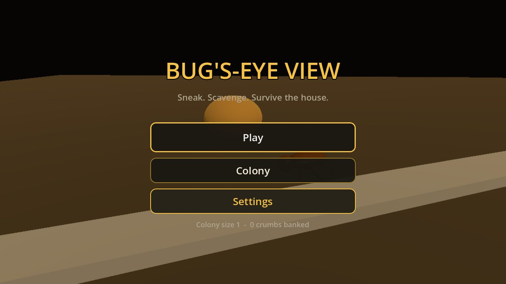
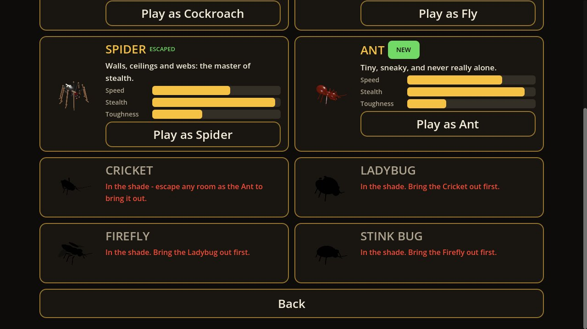
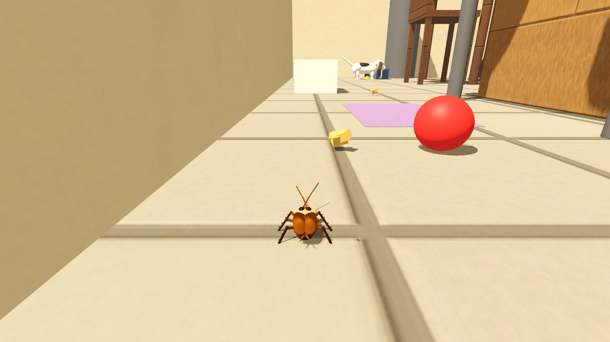
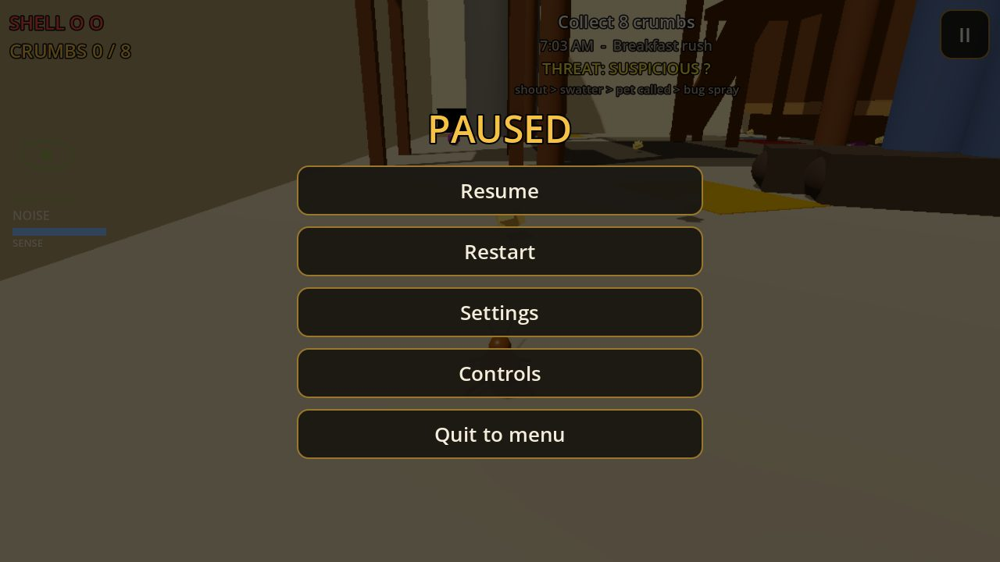

# Bug's-Eye View

An action-stealth survival game in Godot 4.7. You are a tiny household bug
in a giant human home: scavenge crumbs, stay unseen, unheard and unsmelled,
and escape. One codebase for Android, iOS, Windows, macOS, Linux and the web.

- How to open, play, test and export: [RUN.md](RUN.md)
- What each store needs: [docs/STORE_EXPORT_CHECKLIST.md](docs/STORE_EXPORT_CHECKLIST.md)
- The prompt this was built from: [../../prompts/claude/bugs-eye-view.md](../../prompts/claude/bugs-eye-view.md)

## What's in the game

**Three bugs**
- **Cockroach** (unlocked from the start): fast, squeezes flat into gaps to
  hide, survives one extra hit with a knockdown, plays dead near a suspicious
  threat, smells crumbs with its antennae, runs faster in the dark and bolts
  when a light flicks on.
- **Fly** (escape the Kitchen): buzzy, level 3D flight that hovers in place
  when you let go, climbs where you look, rides warm updrafts over the stove,
  lamps and grill, and pesters people and pets. Compound-eye slow motion when
  a strike is about to land, and escape moves: burst, evasive loop, silent
  dive, clinging to walls and ceilings, jinking, and a silent glide when
  stamina runs out.
- **Spider** (escape the Living Room): walks on walls and ceilings, zips on
  web lines that stay behind as bridges, spins web traps, feels footsteps as
  ripples through walls.

**Three big rooms, each with a boss chase when the exit opens**
- **Kitchen**: the human's feet and swatter, a sink drain, a glue trap, the
  fridge light, an island, a pantry, pet bowls and a mop bucket. Boss:
  *Cleaning Day* (the robot vacuum hunts your noise, then the spray comes out).
- **Living Room**: the TV masks your noise but its glow exposes you, a fan
  blows flyers off course, a reading corner with an armchair and an aquarium
  (bubbles mask you, its glow gives you away), the cat leaps onto furniture
  and knocks things over. Boss: *The Cat*.
- **Backyard**: open sky, a dog that follows your scent trail, sprinklers,
  puddles and a bird bath that wash it away, crunchy leaf piles and compost, a
  vegetable garden and a garden shed. Boss: *The Exterminator*, a fog front
  that sweeps the yard.

**Bug food and crumb gems**: sugar, cheese, mint, honey, coffee and kibble
give short boosts; six glowing gems give real powers (near-invisibility,
freezing everyone, calming the alarm, an iron shell, a crumb magnet, an echo
decoy).

**People and animals**: humans have full bodies (faces, hair, hands, outfits)
that walk with bending knees and swinging arms, turn their heads toward
noises and raise the swatting arm when they spot you. Each room's person has
things they do: the cook cooks, washes up and snacks (dropping crumbs), the
reader reads behind the paper and naps on the couch, the gardener waters,
kneels in the vegetables and plays fetch with the dog. The puppy, cat and dog
are playful when calm (balls, zoomies, play-pounces), alert when something's
up, leap at a low-flying fly, and get sharper room by room.

**Bugs**: jointed
legs that scuttle in a real gait, twitching antennae, wing veins, eight
spider eyes and fangs; they clean their antennae when left idle.

**Stealth systems**
- Light and shadow zones, noisy and quiet surfaces, ambient noise that masks
  you, freezing in place and camouflage on matching surfaces.
- A house-wide alarm gauge fills while you're seen or heard. On their own,
  threats only investigate (? then searching); at 100% every human and pet in
  the room is alerted at once. Hiding drains it.
- Places to hide in every room: crawl inside a paper cup, a sneaker, a
  grocery bag, a slipper, a fallen pillow, a flowerpot or a coiled hose and
  you're invisible and out of reach; mail stacks, toy blocks, rocks and a
  garden gnome block sight lines; tall grass keeps you in shade.
- Escalation chain: a human who spots you shouts, grabs the swatter, calls the
  pet, then brings out the bug spray.
- Lures (phone, spoon, TV remote, knocked-off peas) and turning threats on
  each other (a swatter clanging off a pan, a foot on a grape, a mug knocked
  onto a foot).

**A living house**: each room runs a compressed daily routine (breakfast,
nap, dishes, cleaning, lights out) that changes who is there and what is lit.
Pick morning, afternoon or night once you've escaped a room.

**Progress**: crumbs feed your colony, which grows and unlocks upgrades.
Badges per room: Ghost (never spotted), Speedrun, Golden Crumb (found at the
end of each room's secret route).

**Feel**: phone vibration and gamepad rumble on footsteps and near misses,
giant muffled human voices, a heartbeat that rises when you're hunted.

## Status

All six build phases from the prompt are done. Placeholder art and sound
throughout (generated primitives and synthesized audio), ready to swap.
Every bug, threat, pickup, hiding spot and big piece of furniture has a slot
for a generated 3D model (84 in all); `tools/meshy/generate.py` makes them with Meshy
(needs your Meshy API key; see [tools/meshy/README.md](tools/meshy/README.md)).

- Two headless test suites pass in the project and in an exported build
  (`tools/run_tests.sh`): a 120-check smoke test and a 285-check phase audit
  that walks the spec phase by phase, plus every update since (alarm gauge,
  fly moves, hiding spots, model slots, bigger rooms, people, bug detail, food
  and gems, flying, animals and people's activities). Zero GDScript warnings, zero engine errors.
- Ideas and ready-made prompts for what to build next:
  [docs/TOOL_IDEAS.md](docs/TOOL_IDEAS.md),
  [../../prompts/claude/bugs-eye-view-next.md](../../prompts/claude/bugs-eye-view-next.md),
  [../../prompts/codex/bugs-eye-view-tasks.md](../../prompts/codex/bugs-eye-view-tasks.md).
- Android test app (debug-signed): [dist/android/bugseyeview-debug.apk](dist/android/bugseyeview-debug.apk).
- Builds produced and checked: Android debug APK (signed), Windows, macOS,
  Linux, Web, and the iOS Xcode project. The web build was played in a
  browser at desktop and phone sizes.
- Not done here: the Google Play AAB (needs the Android SDK on your machine)
  and the signed iOS build (needs a Mac or a cloud Mac). See the checklist.

| | |
|---|---|
|  |  |
|  |  |
