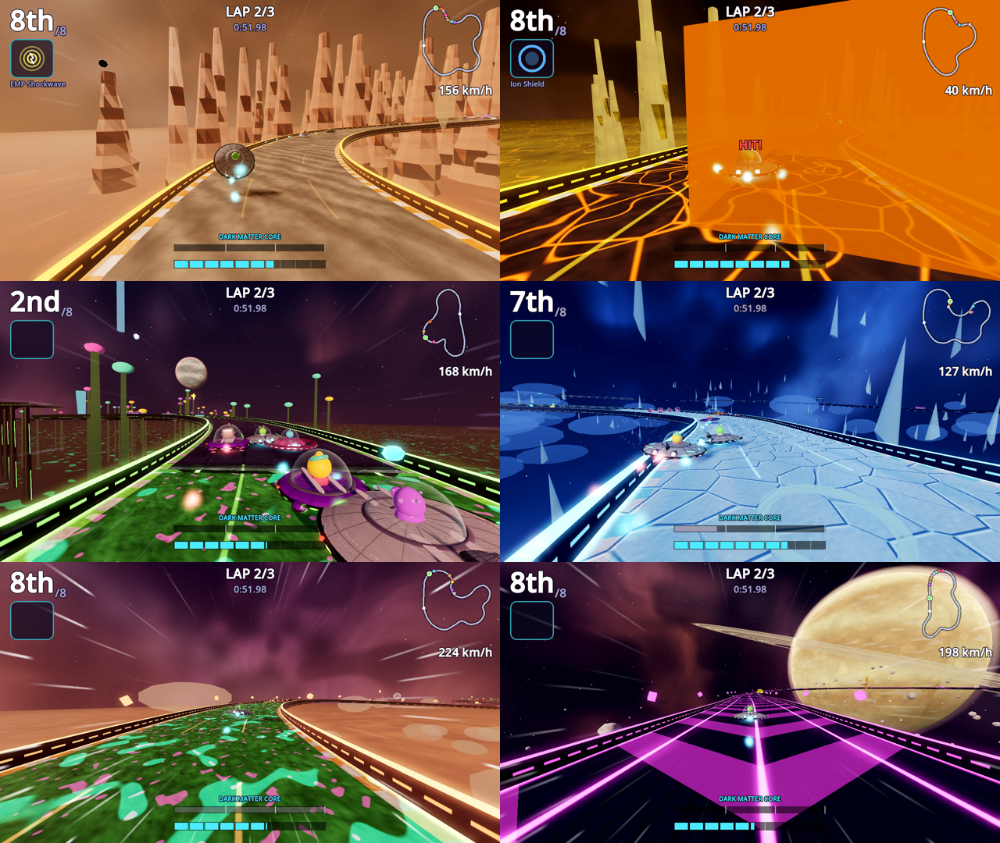
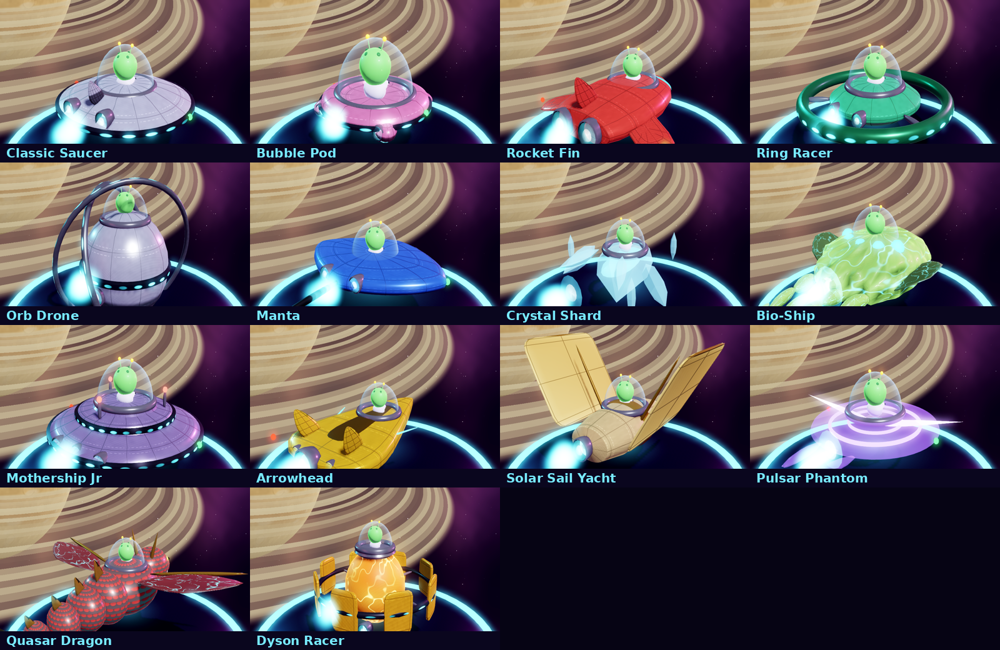
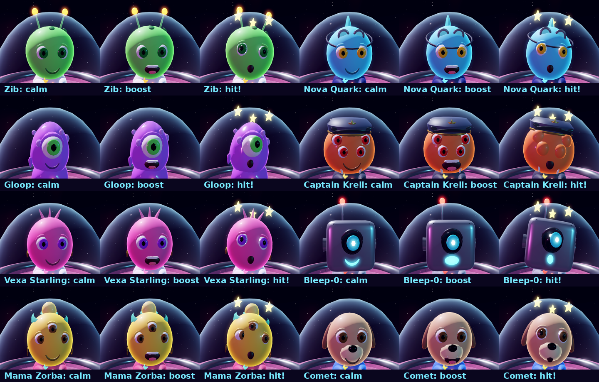

# Cosmic Saucer Drift

Arcade UFO kart racing across real planets and star systems. Android
(Google Play first), plus Web, Windows, macOS and Linux from the same Godot
4.7 project. Pick-up-and-play handling, drifts that charge a Plasma Boost,
eight power-ups, alien spacecraft, and a Dark Matter core you have to keep
charged.

Built from [`prompts/claude/cosmic-saucer-drift.md`](../../prompts/claude/cosmic-saucer-drift.md)
(v1 concept + every add-on chosen, then v2: real systems, alien spacecraft,
premium craft, power-up lineups; v3: HD graphics, characters and feel).
Next steps:
[`prompts/claude/cosmic-saucer-drift-next.md`](../../prompts/claude/cosmic-saucer-drift-next.md).



## HD graphics (v3)

Everything is still generated from code, now in much finer detail:

- **Craft:** all 14 rebuilt with smooth bevelled hulls (turned profiles and
  rounded shapes), panel seams and rivets, glossy paint, chrome trim, running
  lights that chase when you boost, red/green nav lights, real engine nozzles
  with live flickering flames, glass cockpits, a soft shadow or real
  shadows, and a hex-pattern Ion Shield. Static parts are baked into one mesh
  per material, so eight detailed craft stay cheap to draw.
- **Pilots:** every alien has its own face and outfit (Zib's antennae, Nova's
  goggles, Gloop's slime, Captain Krell's cap and tusks, Vexa's star crest,
  Bleep-0's camera eye, Mama Zorba's headscarf, Comet's ears and snout).
  Eyes blink and look where you steer; faces change with the race: a
  determined squint when drifting, a toothy grin on boost, dizzy spinning
  eyes and stars when hit, wide-eyed when the core runs dry, cheering after
  a podium finish. Arms work the control yoke and go up to celebrate.
- **Worlds:** plated, rippled, cracked or mossy road surfaces with bump
  detail, ice glints and glowing lava cracks; striped kerbs; barrier panels
  with light strips; eroded rock spires with layered strata; skies with
  layered nebulae, dust lanes, a galaxy band and coloured stars; planets with
  craters or storm bands and glowing atmospheres; sky reflections; shadows.
- **Effects & camera:** boost shockwaves, impact flashes and sparks, wall
  scrapes, landing dust, drift-spark glows by tier, speed lines; a chase
  camera that stretches with speed, swings out in drifts, punches the field
  of view on boosts and dips on hard landings; slow motion and a camera swing
  to your cheering pilot at the finish.
- **Graphics tiers:** Low, Medium, High and Ultra (Settings > Graphics, or
  Auto, which picks one from the device and steps down live if frames drop).
  Ultra/High add 4x/2x anti-aliasing, real-time shadows, reflections and full
  detail; Medium and Low keep phones smooth.
- **Smooth motion:** racers, power-ups and hazards are interpolated between
  physics steps (the camera follows the smoothed position), so motion stays
  smooth when a phone can't hold a steady frame rate; phones and browsers
  never pile up catch-up steps after a slow frame, and phone browsers start
  on Low.




## Real places

Each cup is a real star system and each track a real planet or moon, with
three fact cards (shown on track select, during the countdown, in pause and
on the results screen), the real star(s) drawn in the sky and gravity tuned
per world (Mars and Io float you further off jumps; 55 Cancri e is heavier).
Where science is unsure, the game says "may"; where the game makes things up
(TRAPPIST-1e's plants, Proxima Station) it says so.

| Cup | Tracks |
|---|---|
| Our Solar System | Mars: Valles Marineris · Ceres & the Asteroid Belt · Io: Volcano Moon · Saturn's Rings |
| TRAPPIST-1 (40 ly) | 1b Scorched World · 1e Twilight Garden · 1h Frozen Edge |
| Alpha Centauri (4.2-4.4 ly) | Proxima b: Flare Run · Proxima Station · Twin Suns circuit |
| Exoplanet Extremes | HD 189733 b: Blue Storm (supersonic winds, glass rain) · 55 Cancri e: Lava Planet · Kepler-16b: Two Sunsets · WASP-76 b: Iron Rain |
| Galactic Grand Prix | finale: reverse and mirror tracks from every system |

Every track has moving hazards (tumbling asteroids, Martian dust devils and
dust storms, solar flares, station lasers, snapping alien plants, geysers,
falling ice/glass/iron, lava eruptions, supersonic gusts), one hidden
shortcut, three Star Shards, and Reverse + Mirror versions that unlock when
you win it: 14 tracks, 42 layouts.

## Cockpit view

A **COCKPIT** tab sits on the left edge of the race screen. Tap it (or press
V, or Back on a gamepad) at any moment in any race to fly first-person from
your pilot's seat, and again to go back to the chase camera. Inside you see
your craft's deck ahead of you, a canopy frame and a dashboard with a speed
dial and boost lamp; the view banks into turns, follows part of a drift, and
stays level through hits and tricks. Your own pilot is hidden only from your
view (in split-screen each player has their own tab). The choice is
remembered (also in Settings and the pause menu). The race simulator switches
the cockpit on and off on all 42 layouts and checks the camera every time.

## Power-ups and lineups

Eight power-ups from glowing crates: **Homing Rocket**, **Pulse Laser**
(instant beam that hits everything in a line and clears mines), **Comet
Strike** (falls on the leader), **EMP Shockwave** (spins out everyone near you
and knocks their items loose), **Nitro Rocket** (1-3 boosts), **Ion Shield**
(use it for 6 s of protection, or just hold it to block one hit), **Gravity
Mine** and **Tractor Beam**.

Each has its own detailed model and effects: the rocket (fins, flame, smoke
trail) shows a red lock-on ring over its target and warns them; the laser
fires a layered beam with pulses of light; the comet falls as a glowing ice
rock with a flaming tail onto a target marker; the EMP throws an electric
dome and lightning at everyone it hits; nitro straps two boosters onto your
craft; a held shield circles your craft as a hex badge; mines are spiked,
blink, and pulse a gravity ring; the tractor beam streams energy back to you.
Hits look different too: rockets and mines throw a craft up, a comet
squashes it, a laser jolts it, an EMP makes its lights flicker, a tractor
beam pulses it green.

What you can pull depends on your place, in five lineups: Leader (mostly
defence and mines), Front pack, Midfield, Chasers, Last place (Nitro x3,
Comet Strike, EMP). The further back you are, the stronger the comeback
items. Listed in-game under How to Play.

## Spacecraft

14 craft: the Classic Saucer, Bubble Pod, Rocket Fin, Ring Racer, Manta and
Mothership Jr, four new alien designs (Orb Drone, Crystal Shard, Bio-Ship
that slowly heals its core, Arrowhead Interceptor), and four **premium**
craft with perks: Solar Sail Yacht (boosting recharges your core), Pulsar
Phantom (shorter spin-outs), Quasar Dragon (longer drift boosts), Dyson Racer
(pods refill 50% more). Everything is unlocked with **Race Credits** earned
in races (premium craft cost 12,000-22,000 and need stars). Four stats to
upgrade per craft, plus paints, decals, domes and trails.

A **real-money store** is built in and switched off (premium craft, a
premium fleet bundle, credit packs, remove ads), ready for Google Play
Billing in an update: [`docs/STORE_PLAN.md`](docs/STORE_PLAN.md). Ads are
built in and switched off too: [`docs/ADS_PLAN.md`](docs/ADS_PLAN.md). v1
has no ads, no purchases and collects no data.

## Also

Drifting with blue/orange/purple Plasma Boosts, rocket starts, slipstream,
tricks off ramps/geysers/bouncy moss, near-miss energy, 8 alien pilots with
passives and boss races, Galactic Cups with 3 stars per race, Quick Race,
Time Trial with your ghost and medals, Daily Challenge with streaks (works
offline), 2-player split-screen, 26 achievements, career stats, touch joystick
with GAS and BRAKE pedals (auto-drive on by default), tilt, ◀ ▶ buttons,
gamepad/keyboard controls, automatic graphics step-down on slow phones.

Fine-tuning in v3: keys and touch buttons ease the steering in (taps make
small corrections), AI catch-up is fairer and depends on the difficulty
(easier classes ease off more when leading; nobody gets a catch-up push in
the last half lap), and rescues put you back with a running start.

## Folders

```
project.godot, export_presets.cfg
autoload/        Save, InputRouter, Events, Ads, Store, Audio, Game
scripts/data/    Catalog (craft, pilots, items, lineups, systems, cups, cosmetics), TrackDefs, Tuning, Achievements
scripts/track/   TrackPath, TrackData (variants, features), TrackBuilder (meshes), TrackDecor, Themes (skies, suns)
scripts/race/    Race, Racer (physics), AIDriver, PlayerDriver, Items, Pickups, Hazards, RaceCamera, SaucerModel (HD craft), RaceAudio
scripts/gfx/     Gfx (quality tiers, shared materials), MeshKit (lathe/blob/merge), PilotModel (faces, moods), RaceFx (pooled effects)
scripts/ui/      MainMenu, MenuStage, Hud, TouchControls, Minimap, ResultsScreen, PauseMenu, UiKit, ItemIcon
scripts/ads/     AdProvider, DebugAdProvider, AdMobAdProvider (template), AdsConfig
scripts/store/   StoreProvider, DebugStoreProvider, PlayBillingStoreProvider (template), StoreConfig
shaders/         road (HD surfaces), barrier, rock, sky, planet, atmo, ring, ground, hull, glass, flame, shield, speedlines, boost pad, spin
resources/       tuning.tres, ads_config.tres, store_config.tres
assets/          audio (generated), icons
tests/           sim (AI races on all 42 layouts), smoke (~670 checks), shots, menu_shots, craft_shots
tools/           run_tests.sh, gen_audio.py, dump/plot tracks, android/apksigner, web_artifact
docs/            store kit, ads + store plans, privacy policy, checklist, screenshots
dist/android/    debug APK to sideload
```

How to run, test and export: [RUN.md](RUN.md).
