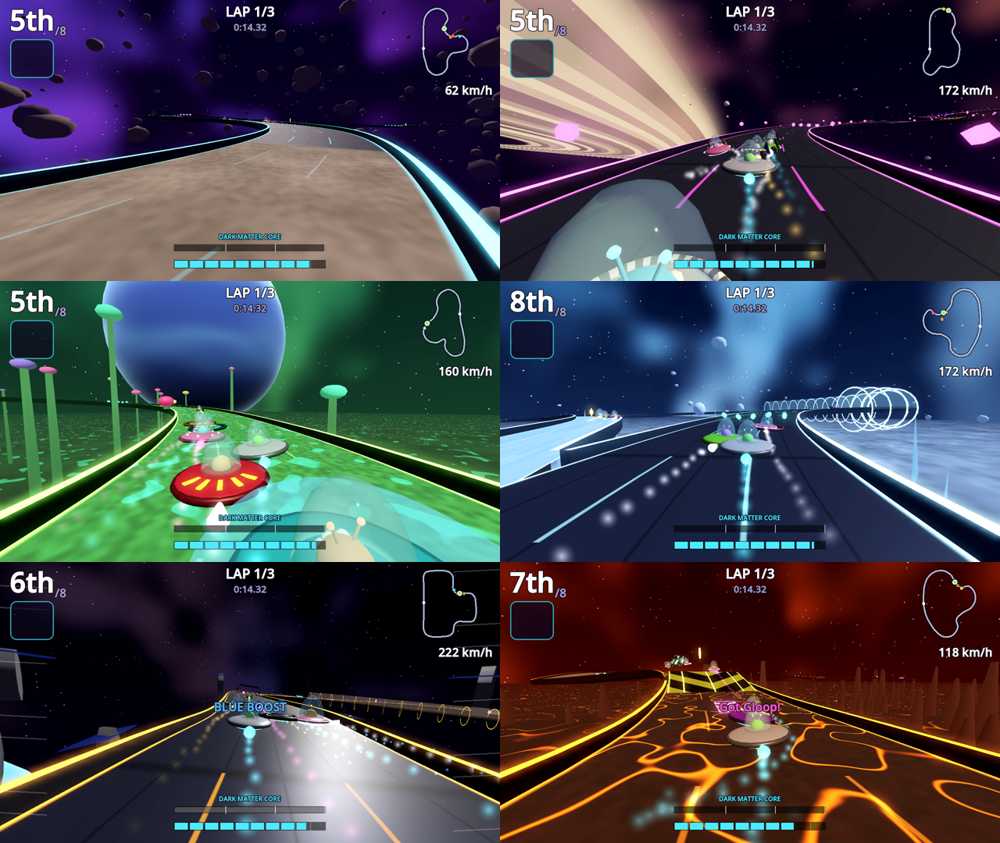

# Cosmic Saucer Drift

Arcade UFO kart racing for Android (Google Play first), plus Web, Windows,
macOS and Linux from the same Godot 4.7 project. Pick-up-and-play handling,
drifts that charge a Plasma Boost, power-up chaos, and a Dark Matter core
you have to keep charged.

Built from [`prompts/claude/cosmic-saucer-drift.md`](../../prompts/claude/cosmic-saucer-drift.md)
(the concept plus every add-on chosen). Next steps for players are in
[`prompts/claude/cosmic-saucer-drift-next.md`](../../prompts/claude/cosmic-saucer-drift-next.md).



## What's in it

**Driving.** Hover physics with snappy steering. Hold DRIFT while turning to
slide; sparks go blue, orange, then purple; let go for a boost that grows with
the drift. Rocket start on GO (too early stalls), slipstream behind rivals,
trick spins in the air (land them for boost + energy), near-miss bonuses.
Surfaces change grip and speed: metal decking, moon dust, comet ice, magnetic
rails (fast, pull you into three lanes), bouncy moss (hops you into the air),
lava rock.

**Dark Matter energy.** The core drains as you fly (Energy Efficiency stat).
Energy Pods, tricks, near misses and slipstreams refill it. Run dry and you
drop into Emergency Hover (about half speed) until you grab a pod. AI follows
the same rules.

**Eight power-ups** from glowing crates, weighted by race position: Tractor
Beam, Meteor Strike, Ion Shield, Hyperspace Warp, Plasma Bolt (homing), Gravity
Mine, Nebula Cloud (smears the screens of everyone ahead), Black Hole.

**Six tracks, eighteen layouts.** The Asteroid Belt, Neon Ring of Saturn,
Alien Jungle Moon, Comet Ice Run, Orbital Station, Lava Moon. Each has moving
hazards (tumbling asteroids, solar flares, snapping plants, geysers, falling
ice, station lasers, lava eruptions), one hidden shortcut (the jungle's is a
bridge you reach by riding a geyser), three Star Shards, jumps, low-gravity
zones, and Reverse and Mirror versions that unlock when you win the track.

**Eight pilots** with passives (Drift Ace, Shield Start, Slow Burner, Bumper,
Lucky Crates, Pod Magnet, Trick Queen, Draft Hound) and AI styles (clean line,
aggressive, item hoarder). Two to start; beat the rest in 1-on-1 Boss Races.

**Six saucers** (Classic Saucer, Bubble Pod, Rocket Fin, Ring Racer, Manta,
Mothership Jr) with four upgradeable stats, and a cosmetic garage (paints,
decals, dome tints, engine trails) paid for with Stardust earned in races.

**Modes.** Galactic Cups (4 cups x 4 races, points, 3 stars per race: top 3,
win, and a race challenge), Quick Race with four rival classes, Time Trial
with your ghost and bronze/silver/gold medals, Boss Races, a date-seeded Daily
Challenge with streaks (works offline), and 2-player split-screen.

**Meta.** 26 achievements with Stardust rewards, career stats, settings
(volume, buttons or tilt steering, auto-accelerate, vibration, shake, camera,
graphics with automatic step-down on slow phones, FPS counter), how-to-play.

**Ads-ready, ads off.** v1 has no ads, no purchases, no tracking. The `Ads`
autoload, placements (rewarded double Stardust, rewarded free item, capped
interstitial between cup races), consent hook, "remove ads" flag and an
`Events` log for future campaign conversion events are all wired in and
switched off. See [`docs/ADS_PLAN.md`](docs/ADS_PLAN.md).

## Folders

```
project.godot, export_presets.cfg
autoload/        Save, InputRouter, Events, Ads, Audio, Game
scripts/data/    Catalog (saucers, pilots, items, cups, cosmetics), TrackDefs, Tuning, Achievements
scripts/track/   TrackPath (spline sampling), TrackData (variants, features), TrackBuilder (meshes), TrackDecor, Themes
scripts/race/    Race, Racer (physics), AIDriver, PlayerDriver, Items, Pickups, Hazards, RaceCamera, SaucerModel, RaceAudio
scripts/ui/      MainMenu, MenuStage, Hud, TouchControls, Minimap, ResultsScreen, PauseMenu, UiKit
scripts/ads/     AdProvider, DebugAdProvider, AdMobAdProvider (template), AdsConfig
shaders/         road, sky, planet, ring, ground, boost pad, spin
resources/       tuning.tres (driving numbers), ads_config.tres (ads switch)
assets/          audio (generated), icons
tests/           sim (AI races on every track), smoke (291 checks), shots, menu_shots
tools/           run_tests.sh, gen_audio.py, dump/plot tracks, android/apksigner, web_artifact
docs/            store kit, ads plan, privacy policy, checklist, screenshots
dist/android/    debug APK to sideload
```

Everything (tracks, saucers, art) is generated from code, so it can be tuned
from data and swapped for real models later. How to run, test and export:
[RUN.md](RUN.md).
