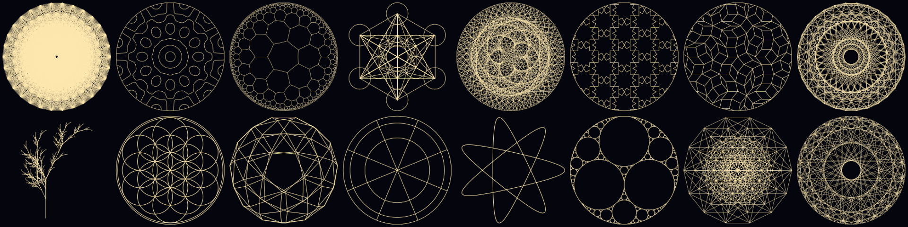

# CYMATIC ODYSSEY

A sealed, low-voltage water chamber that turns sound into geometric light on any wall. Sound shakes a thin layer of water, light passes through it from behind, and the rippling surface focuses that light into living patterns. Printed stencils, dish inserts and wave sources make each look different. A browser console runs themed "voyages" for every holiday.



## Start here

| | |
|---|---|
| [docs/CYMATIC_ODYSSEY_Manual.pdf](docs/CYMATIC_ODYSSEY_Manual.pdf) | **The complete illustrated manual (v2, 77 pages, high-resolution):** how it works, safety, 5 build models, parts and tools, printing (incl. Bambu Lab), 7 illustrated assembly steps rendered from the real STLs, wiring, first light and calibration, an annotated console guide, one page per style (all 30), one page per show (all 15), Blender, videos, troubleshooting, glossary and file index. Every simulated picture carries a SIMULATION mark |
| [downloads/CYMATIC_ODYSSEY_30_style_kits.zip](downloads/CYMATIC_ODYSSEY_30_style_kits.zip) | 30 style kits (gobo STL+SVG, insert STL, dipper STL, previews) + all hardware STLs |
| [docs/SHOWS.md](docs/SHOWS.md) | 15 ten-minute light shows that chain into one 150-minute loop |
| [marketing/videos/](marketing/videos/) + [marketing/VIDEOS.md](marketing/VIDEOS.md) | **15 marketing videos** (one per show, 30 s vertical 1080x1920 with soundtrack) + ready-to-post captions |
| [docs/BAMBU_STUDIO.md](docs/BAMBU_STUDIO.md) + `downloads/CYMATIC_ODYSSEY_Bambu_Studio.zip` | **Bambu Studio:** every STL checked/repaired, 3MF plates per style (incl. two-colour AMS gobos), hardware plates, A1-mini platform; all verified with lib3mf |
| [docs/BLENDER.md](docs/BLENDER.md) + [tools/blender/cymatic_blender.py](tools/blender/cymatic_blender.py) | **Blender add-on + CLI:** bevel/engrave/remesh/decimate any STL, assemble and render the full chamber; `downloads/CYMATIC_ODYSSEY_Blender_enhanced.zip`, renders in `marketing/renders/` |
| [docs/CYMATIC_ODYSSEY_Sourcing_Guide.pdf](docs/CYMATIC_ODYSSEY_Sourcing_Guide.pdf) | Designed PDF: geometric glass to buy, custom glass makers (precision, art studios, 3D crystal engraving), transparent/translucent and effect filaments |
| [docs/SHOPPING_LIST.md](docs/SHOPPING_LIST.md) | Parts list with links, plus glass stores in South Jersey and the Philadelphia area |
| [docs/BUILD_SPECS.md](docs/BUILD_SPECS.md) | How it works, what your EZ-100 Tesla coil can and can't do, specs, parts list (about $300-450), print settings, assembly, calibration |
| [docs/SAFETY.md](docs/SAFETY.md) | **Read first.** Tesla coil + water, low-voltage rules, flicker and photosensitivity, health claims |
| [docs/GEOMETRY_CATALOG.md](docs/GEOMETRY_CATALOG.md) | The research log: 355 printable looks in 26 families, each with its maths, symmetry and source |
| [docs/PHYSICS_AND_PATTERNS.md](docs/PHYSICS_AND_PATTERNS.md) | Faraday waves, dish modes, caustics, spectrum splitting, pattern recognition and generation, references |
| [docs/PHYSICS_TABLES.md](docs/PHYSICS_TABLES.md) | Computed wavelengths, shake needed, natural modes of your dish, two-frequency recipes |
| [docs/VOYAGES.md](docs/VOYAGES.md) | 11 "space odyssey" and introspective shows (frequency programs) |
| [docs/THEMES.md](docs/THEMES.md) | 40 holiday and observance themes: colours, voyage, gobos, insert, pitch |
| [docs/MARKET.md](docs/MARKET.md) | Market section: positioning, product tiers, home and business uses, health claims you can and can't make, compliance |
| [console/index.html](console/index.html) | **Voyage console** ([live page](https://claude.ai/artifact/STJTYLCynV5XHA1uNHifMX)): open in any browser. Tone generator (one or two tones, pulse, breathe, sweep), live caustic preview, voyages, themes, pattern atlas |

## The printable parts

| Kind | Count | Where |
|---|---|---|
| **Gobos** (light stencils, 110 mm). The geometry is refracted by the moving water, so it bends and breathes | 306 | `downloads/gobos_<family>.zip` (STL + SVG for film/laser) |
| **Boundary inserts**: drop into the 150 mm glass dish and change the water's "drum shape" (polygons, stars, chaotic billiards, fractal drum...) | 37 | [stl/inserts/](stl/inserts/) or `downloads/inserts.zip` |
| **Dipper feet**: shaped wave sources (point = rings pulsing outward, two pins = interference, star, cross...) | 12 | [stl/dippers/](stl/dippers/) or `downloads/dippers.zip` |
| **Hardware**: vibration platform (4 exciters), foot cups, dipper arm, LED cradle, lens ring, 45 degree mirror holder, gobo carrier, panel corners, Tesla-coil bay base | 9 | [stl/hardware/](stl/hardware/) |

Contact sheets for every family are in [previews/](previews/).

## Tools

```bash
pip install numpy scipy shapely trimesh manifold3d mapbox_earcut matplotlib pillow
python3 tools/generate.py                  # rebuild every STL/SVG/preview/catalog (about 1 minute)
python3 tools/generate.py --dish-id 142    # refit the inserts to YOUR dish's inside diameter
python3 tools/physics_tables.py            # recompute docs/PHYSICS_TABLES.md
python3 tools/content.py                   # rebuild voyages/themes docs and the console's data
python3 tools/pattern_analyzer.py wall.jpg # what symmetry is on the wall?
python3 tools/mode_mapper.py --simulate    # sweep + camera -> pattern atlas (dry run)
python3 tests/test_tools.py                # checks
python3 docs/manual/build_assets.py        # manual pictures (needs the style kits, Blender renders and Playwright)
python3 docs/manual/build_manual.py        # the manual PDF (HTML -> Chromium print)
```

Add a shape: one `add(...)` line in `tools/odyssey/catalog.py`.

## Status

- Built: geometry engine (polygons to E8), 355 looks + 9 hardware parts generated with 0 failures, sampled meshes checked watertight; physics tables; pattern analyzer (passes symmetry/ring/noise/stability tests); mode mapper (dry run); Voyage console (tested in headless Chromium: no errors, voyages and themes run).
- Not yet tested on real hardware: the chamber hasn't been built, so frequencies, onset levels and optics are calculated, not measured. Print one gobo, one insert and the platform first, then map your system with the console's atlas or `mode_mapper.py`.
- Exciter mounting rings on the platform are 50.5 mm inside diameter: check against your exciters' datasheet before printing.
