# Geometry catalog

355 printable looks, generated by `tools/generate.py`. Every entry lists the maths that draws it and where the shape comes from. IDs: **G** = gobo (light stencil), **B** = boundary insert, **D** = dipper foot.

Previews: `previews/<family>.png` (contact sheets) and `previews/items/`.

| Family | Count | Contact sheet |
|---|---|---|
| [Regular polygons](#regular-polygons) | 11 | [sheet](../previews/polygons.png) |
| [Star polygons {n/k}](#star-polygons-n-k) | 14 | [sheet](../previews/stars.png) |
| [Rose curves r = cos(k theta)](#rose-curves-r-cos-k-theta) | 14 | [sheet](../previews/roses.png) |
| [Lissajous figures (frequency ratios)](#lissajous-figures-frequency-ratios) | 10 | [sheet](../previews/lissajous.png) |
| [Hypotrochoids and epitrochoids](#hypotrochoids-and-epitrochoids) | 12 | [sheet](../previews/spirographs.png) |
| [Classical plane curves](#classical-plane-curves) | 9 | [sheet](../previews/classical.png) |
| [Gielis superformula & superellipses](#gielis-superformula-superellipses) | 12 | [sheet](../previews/superformula.png) |
| [Harmonographs](#harmonographs) | 4 | [sheet](../previews/harmonographs.png) |
| [Torus knots (p,q)](#torus-knots-p-q) | 6 | [sheet](../previews/knots.png) |
| [Spirals & phyllotaxis](#spirals-phyllotaxis) | 6 | [sheet](../previews/spirals.png) |
| [Sacred & cultural geometry](#sacred-cultural-geometry) | 13 | [sheet](../previews/sacred.png) |
| [Number patterns](#number-patterns) | 14 | [sheet](../previews/number.png) |
| [Cosmic dance (real planetary periods)](#cosmic-dance-real-planetary-periods) | 14 | [sheet](../previews/cosmic.png) |
| [Cymatics & wave physics](#cymatics-wave-physics) | 31 | [sheet](../previews/physics.png) |
| [Optical elements](#optical-elements) | 6 | [sheet](../previews/optics.png) |
| [Archimedean tilings](#archimedean-tilings) | 8 | [sheet](../previews/tilings.png) |
| [Islamic star patterns (Hankin method)](#islamic-star-patterns-hankin-method) | 12 | [sheet](../previews/islamic.png) |
| [Quasicrystal tilings (de Bruijn multigrid)](#quasicrystal-tilings-de-bruijn-multigrid) | 5 | [sheet](../previews/quasicrystal.png) |
| [Hyperbolic tilings {p,q} (Poincare disc)](#hyperbolic-tilings-p-q-poincare-disc) | 9 | [sheet](../previews/hyperbolic.png) |
| [Platonic solids (3 views each)](#platonic-solids-3-views-each) | 15 | [sheet](../previews/platonic.png) |
| [Archimedean solids](#archimedean-solids) | 13 | [sheet](../previews/archimedean.png) |
| [Catalan solids (Archimedean duals)](#catalan-solids-archimedean-duals) | 13 | [sheet](../previews/catalan.png) |
| [Kepler-Poinsot solids & compounds](#kepler-poinsot-solids-compounds) | 11 | [sheet](../previews/stellated.png) |
| [4D+ polytopes in Coxeter planes](#4d-polytopes-in-coxeter-planes) | 20 | [sheet](../previews/polytopes4d.png) |
| [Fractals & space-filling curves](#fractals-space-filling-curves) | 24 | [sheet](../previews/fractals.png) |
| [Boundary inserts (the water's 'drum shape')](#boundary-inserts-the-water-s-drum-shape) | 37 | [sheet](../previews/insert.png) |
| [Dipper feet (wave sources)](#dipper-feet-wave-sources) | 12 | [sheet](../previews/dipper.png) |

## Regular polygons

**Look:** Clean n-sided frames; through rippling water the edges shimmer and bow.

**Sources:** Euclid, Elements Book IV; Gauss (1796) constructible 17-gon

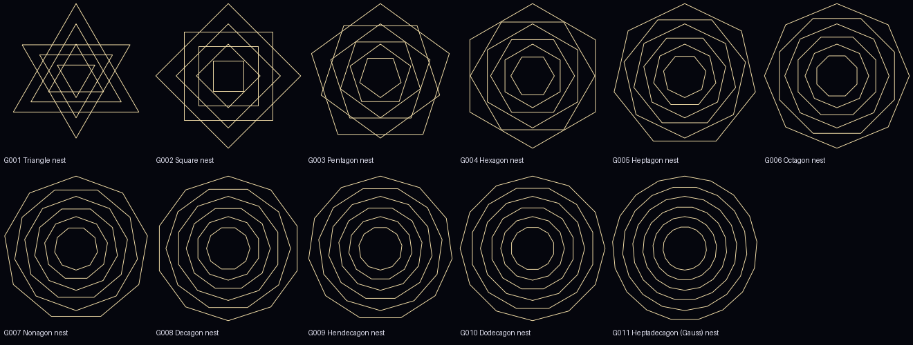

| ID | Name | Maths | Symmetry | File |
|---|---|---|---|---|
| G001 | Triangle nest | Regular 3-gon, 6 nested rings alternately rotated pi/3 | D3 (dihedral, 3-fold) | [gobos_polygons.zip](../downloads/gobos_polygons.zip) `G001_triangle_nest.stl` |
| G002 | Square nest | Regular 4-gon, 6 nested rings alternately rotated pi/4 | D4 (dihedral, 4-fold) | [gobos_polygons.zip](../downloads/gobos_polygons.zip) `G002_square_nest.stl` |
| G003 | Pentagon nest | Regular 5-gon, 6 nested rings alternately rotated pi/5 | D5 (dihedral, 5-fold) | [gobos_polygons.zip](../downloads/gobos_polygons.zip) `G003_pentagon_nest.stl` |
| G004 | Hexagon nest | Regular 6-gon, 6 nested rings alternately rotated pi/6 | D6 (dihedral, 6-fold) | [gobos_polygons.zip](../downloads/gobos_polygons.zip) `G004_hexagon_nest.stl` |
| G005 | Heptagon nest | Regular 7-gon, 6 nested rings alternately rotated pi/7 | D7 (dihedral, 7-fold) | [gobos_polygons.zip](../downloads/gobos_polygons.zip) `G005_heptagon_nest.stl` |
| G006 | Octagon nest | Regular 8-gon, 6 nested rings alternately rotated pi/8 | D8 (dihedral, 8-fold) | [gobos_polygons.zip](../downloads/gobos_polygons.zip) `G006_octagon_nest.stl` |
| G007 | Nonagon nest | Regular 9-gon, 6 nested rings alternately rotated pi/9 | D9 (dihedral, 9-fold) | [gobos_polygons.zip](../downloads/gobos_polygons.zip) `G007_nonagon_nest.stl` |
| G008 | Decagon nest | Regular 10-gon, 6 nested rings alternately rotated pi/10 | D10 (dihedral, 10-fold) | [gobos_polygons.zip](../downloads/gobos_polygons.zip) `G008_decagon_nest.stl` |
| G009 | Hendecagon nest | Regular 11-gon, 6 nested rings alternately rotated pi/11 | D11 (dihedral, 11-fold) | [gobos_polygons.zip](../downloads/gobos_polygons.zip) `G009_hendecagon_nest.stl` |
| G010 | Dodecagon nest | Regular 12-gon, 6 nested rings alternately rotated pi/12 | D12 (dihedral, 12-fold) | [gobos_polygons.zip](../downloads/gobos_polygons.zip) `G010_dodecagon_nest.stl` |
| G011 | Heptadecagon (Gauss) nest | Regular 17-gon, 6 nested rings alternately rotated pi/17 | D17 (dihedral, 17-fold) | [gobos_polygons.zip](../downloads/gobos_polygons.zip) `G011_heptadecagon_gauss_nest.stl` |

## Star polygons {n/k}

**Look:** Pointed stars and compound stars; strong radial beams on the wall.

**Sources:** Schlaefli symbols; H.S.M. Coxeter, Regular Polytopes (1973)

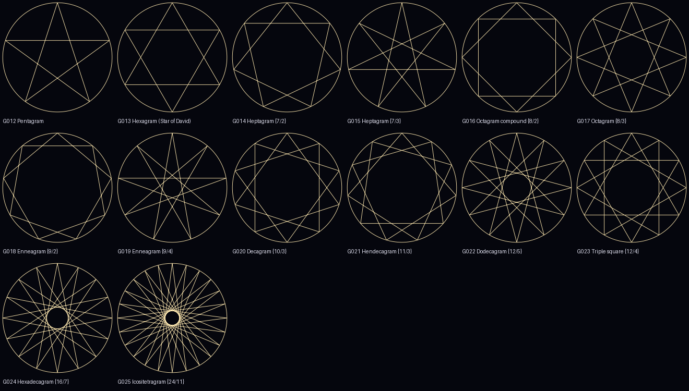

| ID | Name | Maths | Symmetry | File |
|---|---|---|---|---|
| G012 | Pentagram | Star polygon {5/2}: join every 2th of 5 points | D5 (dihedral, 5-fold) | [gobos_stars.zip](../downloads/gobos_stars.zip) `G012_pentagram.stl` |
| G013 | Hexagram (Star of David) | Star polygon {6/2}: join every 2th of 6 points | D6 (dihedral, 6-fold) | [gobos_stars.zip](../downloads/gobos_stars.zip) `G013_hexagram_star_of_david.stl` |
| G014 | Heptagram {7/2} | Star polygon {7/2}: join every 2th of 7 points | D7 (dihedral, 7-fold) | [gobos_stars.zip](../downloads/gobos_stars.zip) `G014_heptagram_7_2.stl` |
| G015 | Heptagram {7/3} | Star polygon {7/3}: join every 3th of 7 points | D7 (dihedral, 7-fold) | [gobos_stars.zip](../downloads/gobos_stars.zip) `G015_heptagram_7_3.stl` |
| G016 | Octagram compound {8/2} | Star polygon {8/2}: join every 2th of 8 points | D8 (dihedral, 8-fold) | [gobos_stars.zip](../downloads/gobos_stars.zip) `G016_octagram_compound_8_2.stl` |
| G017 | Octagram {8/3} | Star polygon {8/3}: join every 3th of 8 points | D8 (dihedral, 8-fold) | [gobos_stars.zip](../downloads/gobos_stars.zip) `G017_octagram_8_3.stl` |
| G018 | Enneagram {9/2} | Star polygon {9/2}: join every 2th of 9 points | D9 (dihedral, 9-fold) | [gobos_stars.zip](../downloads/gobos_stars.zip) `G018_enneagram_9_2.stl` |
| G019 | Enneagram {9/4} | Star polygon {9/4}: join every 4th of 9 points | D9 (dihedral, 9-fold) | [gobos_stars.zip](../downloads/gobos_stars.zip) `G019_enneagram_9_4.stl` |
| G020 | Decagram {10/3} | Star polygon {10/3}: join every 3th of 10 points | D10 (dihedral, 10-fold) | [gobos_stars.zip](../downloads/gobos_stars.zip) `G020_decagram_10_3.stl` |
| G021 | Hendecagram {11/3} | Star polygon {11/3}: join every 3th of 11 points | D11 (dihedral, 11-fold) | [gobos_stars.zip](../downloads/gobos_stars.zip) `G021_hendecagram_11_3.stl` |
| G022 | Dodecagram {12/5} | Star polygon {12/5}: join every 5th of 12 points | D12 (dihedral, 12-fold) | [gobos_stars.zip](../downloads/gobos_stars.zip) `G022_dodecagram_12_5.stl` |
| G023 | Triple square {12/4} | Star polygon {12/4}: join every 4th of 12 points | D12 (dihedral, 12-fold) | [gobos_stars.zip](../downloads/gobos_stars.zip) `G023_triple_square_12_4.stl` |
| G024 | Hexadecagram {16/7} | Star polygon {16/7}: join every 7th of 16 points | D16 (dihedral, 16-fold) | [gobos_stars.zip](../downloads/gobos_stars.zip) `G024_hexadecagram_16_7.stl` |
| G025 | Icositetragram {24/11} | Star polygon {24/11}: join every 11th of 24 points | D24 (dihedral, 24-fold) | [gobos_stars.zip](../downloads/gobos_stars.zip) `G025_icositetragram_24_11.stl` |

## Rose curves r = cos(k theta)

**Look:** Petalled flowers; integer k gives k or 2k petals, fractional k weaves overlapping petals.

**Sources:** Guido Grandi, 'Flores geometrici' (1728)

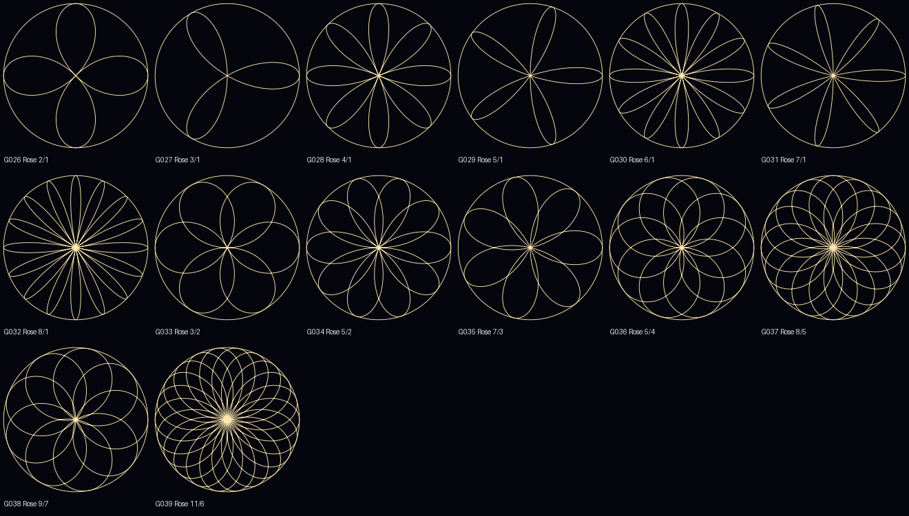

| ID | Name | Maths | Symmetry | File |
|---|---|---|---|---|
| G026 | Rose 2/1 | r = cos(2/1 theta) | D4 (dihedral, 4-fold) | [gobos_roses.zip](../downloads/gobos_roses.zip) `G026_rose_2_1.stl` |
| G027 | Rose 3/1 | r = cos(3/1 theta) | D3 (dihedral, 3-fold) | [gobos_roses.zip](../downloads/gobos_roses.zip) `G027_rose_3_1.stl` |
| G028 | Rose 4/1 | r = cos(4/1 theta) | D8 (dihedral, 8-fold) | [gobos_roses.zip](../downloads/gobos_roses.zip) `G028_rose_4_1.stl` |
| G029 | Rose 5/1 | r = cos(5/1 theta) | D5 (dihedral, 5-fold) | [gobos_roses.zip](../downloads/gobos_roses.zip) `G029_rose_5_1.stl` |
| G030 | Rose 6/1 | r = cos(6/1 theta) | D12 (dihedral, 12-fold) | [gobos_roses.zip](../downloads/gobos_roses.zip) `G030_rose_6_1.stl` |
| G031 | Rose 7/1 | r = cos(7/1 theta) | D7 (dihedral, 7-fold) | [gobos_roses.zip](../downloads/gobos_roses.zip) `G031_rose_7_1.stl` |
| G032 | Rose 8/1 | r = cos(8/1 theta) | D16 (dihedral, 16-fold) | [gobos_roses.zip](../downloads/gobos_roses.zip) `G032_rose_8_1.stl` |
| G033 | Rose 3/2 | r = cos(3/2 theta) | D6 (dihedral, 6-fold) | [gobos_roses.zip](../downloads/gobos_roses.zip) `G033_rose_3_2.stl` |
| G034 | Rose 5/2 | r = cos(5/2 theta) | D10 (dihedral, 10-fold) | [gobos_roses.zip](../downloads/gobos_roses.zip) `G034_rose_5_2.stl` |
| G035 | Rose 7/3 | r = cos(7/3 theta) | D7 (dihedral, 7-fold) | [gobos_roses.zip](../downloads/gobos_roses.zip) `G035_rose_7_3.stl` |
| G036 | Rose 5/4 | r = cos(5/4 theta) | D10 (dihedral, 10-fold) | [gobos_roses.zip](../downloads/gobos_roses.zip) `G036_rose_5_4.stl` |
| G037 | Rose 8/5 | r = cos(8/5 theta) | D16 (dihedral, 16-fold) | [gobos_roses.zip](../downloads/gobos_roses.zip) `G037_rose_8_5.stl` |
| G038 | Rose 9/7 | r = cos(9/7 theta) | D9 (dihedral, 9-fold) | [gobos_roses.zip](../downloads/gobos_roses.zip) `G038_rose_9_7.stl` |
| G039 | Rose 11/6 | r = cos(11/6 theta) | D22 (dihedral, 22-fold) | [gobos_roses.zip](../downloads/gobos_roses.zip) `G039_rose_11_6.stl` |

## Lissajous figures (frequency ratios)

**Look:** The picture of two frequencies at a ratio - the same ratios the Voyage console plays.

**Sources:** N. Bowditch (1815); J.A. Lissajous (1857)

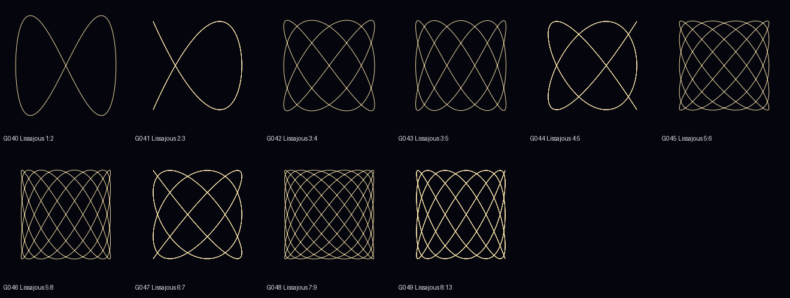

| ID | Name | Maths | Symmetry | File |
|---|---|---|---|---|
| G040 | Lissajous 1:2 | x = sin(1t + pi/2), y = sin(2t) | D2 | [gobos_lissajous.zip](../downloads/gobos_lissajous.zip) `G040_lissajous_1_2.stl` |
| G041 | Lissajous 2:3 | x = sin(2t + pi/2), y = sin(3t) | D2 | [gobos_lissajous.zip](../downloads/gobos_lissajous.zip) `G041_lissajous_2_3.stl` |
| G042 | Lissajous 3:4 | x = sin(3t + pi/2), y = sin(4t) | D2 | [gobos_lissajous.zip](../downloads/gobos_lissajous.zip) `G042_lissajous_3_4.stl` |
| G043 | Lissajous 3:5 | x = sin(3t + pi/2), y = sin(5t) | D2 | [gobos_lissajous.zip](../downloads/gobos_lissajous.zip) `G043_lissajous_3_5.stl` |
| G044 | Lissajous 4:5 | x = sin(4t + pi/2), y = sin(5t) | D2 | [gobos_lissajous.zip](../downloads/gobos_lissajous.zip) `G044_lissajous_4_5.stl` |
| G045 | Lissajous 5:6 | x = sin(5t + pi/2), y = sin(6t) | D2 | [gobos_lissajous.zip](../downloads/gobos_lissajous.zip) `G045_lissajous_5_6.stl` |
| G046 | Lissajous 5:8 | x = sin(5t + pi/2), y = sin(8t) | D2 | [gobos_lissajous.zip](../downloads/gobos_lissajous.zip) `G046_lissajous_5_8.stl` |
| G047 | Lissajous 6:7 | x = sin(6t + pi/2), y = sin(7t) | D2 | [gobos_lissajous.zip](../downloads/gobos_lissajous.zip) `G047_lissajous_6_7.stl` |
| G048 | Lissajous 7:9 | x = sin(7t + pi/2), y = sin(9t) | D2 | [gobos_lissajous.zip](../downloads/gobos_lissajous.zip) `G048_lissajous_7_9.stl` |
| G049 | Lissajous 8:13 | x = sin(8t + pi/2), y = sin(13t) | D2 | [gobos_lissajous.zip](../downloads/gobos_lissajous.zip) `G049_lissajous_8_13.stl` |

## Hypotrochoids and epitrochoids

**Look:** Looping gear-drawn lace; dense rings that read as rotating halos.

**Sources:** Roulette curves; Denys Fisher's Spirograph (1965)

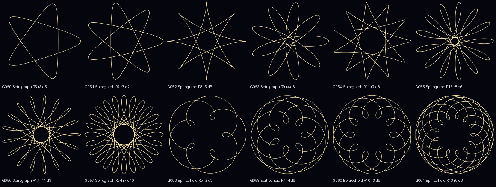

| ID | Name | Maths | Symmetry | File |
|---|---|---|---|---|
| G050 | Spirograph R5 r3 d5 | Hypotrochoid R=5, r=3, d=5 |  | [gobos_spirographs.zip](../downloads/gobos_spirographs.zip) `G050_spirograph_r5_r3_d5.stl` |
| G051 | Spirograph R7 r3 d2 | Hypotrochoid R=7, r=3, d=2 |  | [gobos_spirographs.zip](../downloads/gobos_spirographs.zip) `G051_spirograph_r7_r3_d2.stl` |
| G052 | Spirograph R8 r5 d5 | Hypotrochoid R=8, r=5, d=5 |  | [gobos_spirographs.zip](../downloads/gobos_spirographs.zip) `G052_spirograph_r8_r5_d5.stl` |
| G053 | Spirograph R9 r4 d6 | Hypotrochoid R=9, r=4, d=6 |  | [gobos_spirographs.zip](../downloads/gobos_spirographs.zip) `G053_spirograph_r9_r4_d6.stl` |
| G054 | Spirograph R11 r7 d8 | Hypotrochoid R=11, r=7, d=8 |  | [gobos_spirographs.zip](../downloads/gobos_spirographs.zip) `G054_spirograph_r11_r7_d8.stl` |
| G055 | Spirograph R13 r8 d6 | Hypotrochoid R=13, r=8, d=6 |  | [gobos_spirographs.zip](../downloads/gobos_spirographs.zip) `G055_spirograph_r13_r8_d6.stl` |
| G056 | Spirograph R17 r11 d9 | Hypotrochoid R=17, r=11, d=9 |  | [gobos_spirographs.zip](../downloads/gobos_spirographs.zip) `G056_spirograph_r17_r11_d9.stl` |
| G057 | Spirograph R24 r7 d10 | Hypotrochoid R=24, r=7, d=10 |  | [gobos_spirographs.zip](../downloads/gobos_spirographs.zip) `G057_spirograph_r24_r7_d10.stl` |
| G058 | Epitrochoid R5 r2 d3 | Epitrochoid R=5, r=2, d=3 |  | [gobos_spirographs.zip](../downloads/gobos_spirographs.zip) `G058_epitrochoid_r5_r2_d3.stl` |
| G059 | Epitrochoid R7 r4 d6 | Epitrochoid R=7, r=4, d=6 |  | [gobos_spirographs.zip](../downloads/gobos_spirographs.zip) `G059_epitrochoid_r7_r4_d6.stl` |
| G060 | Epitrochoid R10 r3 d5 | Epitrochoid R=10, r=3, d=5 |  | [gobos_spirographs.zip](../downloads/gobos_spirographs.zip) `G060_epitrochoid_r10_r3_d5.stl` |
| G061 | Epitrochoid R13 r6 d8 | Epitrochoid R=13, r=6, d=8 |  | [gobos_spirographs.zip](../downloads/gobos_spirographs.zip) `G061_epitrochoid_r13_r6_d8.stl` |

## Classical plane curves

**Look:** Single elegant outlines - hearts, kidneys, cusped stars, infinity loops.

**Sources:** Cardioid (Castillon 1741), nephroid (Huygens), deltoid (Euler 1745), astroid (Roemer 1674), lemniscate (J. Bernoulli 1694), Cassini ovals (1680)

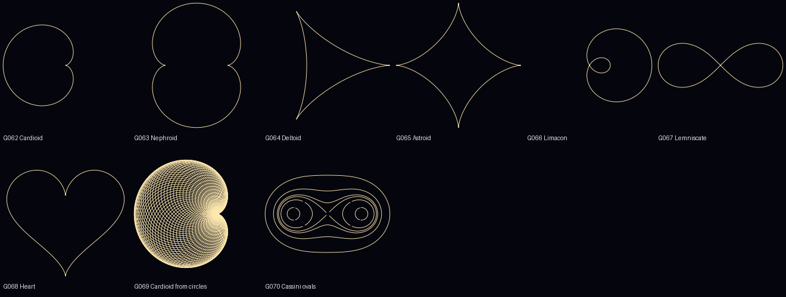

| ID | Name | Maths | Symmetry | File |
|---|---|---|---|---|
| G062 | Cardioid | Classical curve: cardioid |  | [gobos_classical.zip](../downloads/gobos_classical.zip) `G062_cardioid.stl` |
| G063 | Nephroid | Classical curve: nephroid |  | [gobos_classical.zip](../downloads/gobos_classical.zip) `G063_nephroid.stl` |
| G064 | Deltoid | Classical curve: deltoid |  | [gobos_classical.zip](../downloads/gobos_classical.zip) `G064_deltoid.stl` |
| G065 | Astroid | Classical curve: astroid |  | [gobos_classical.zip](../downloads/gobos_classical.zip) `G065_astroid.stl` |
| G066 | Limacon | Classical curve: limacon |  | [gobos_classical.zip](../downloads/gobos_classical.zip) `G066_limacon.stl` |
| G067 | Lemniscate | Classical curve: lemniscate |  | [gobos_classical.zip](../downloads/gobos_classical.zip) `G067_lemniscate.stl` |
| G068 | Heart | Classical curve: heart |  | [gobos_classical.zip](../downloads/gobos_classical.zip) `G068_heart.stl` |
| G069 | Cardioid from circles | Envelope of 72 circles centred on a circle, all through one point |  | [gobos_classical.zip](../downloads/gobos_classical.zip) `G069_cardioid_from_circles.stl` |
| G070 | Cassini ovals | /z-1//z+1/ = b^2 for six values of b (incl. the lemniscate b=1) | D2 | [gobos_classical.zip](../downloads/gobos_classical.zip) `G070_cassini_ovals.stl` |

## Gielis superformula & superellipses

**Look:** Organic starfish, shells, squircles - one equation, endless natural forms.

**Sources:** J. Gielis, American Journal of Botany 90(3) 2003; G. Lame (1818); Piet Hein

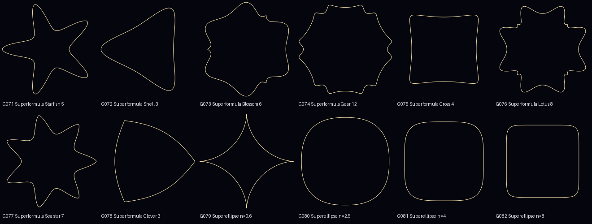

| ID | Name | Maths | Symmetry | File |
|---|---|---|---|---|
| G071 | Superformula Starfish 5 | Gielis superformula m=5, n1=2, n2=7, n3=7 |  | [gobos_superformula.zip](../downloads/gobos_superformula.zip) `G071_superformula_starfish_5.stl` |
| G072 | Superformula Shell 3 | Gielis superformula m=3, n1=4.5, n2=10, n3=10 |  | [gobos_superformula.zip](../downloads/gobos_superformula.zip) `G072_superformula_shell_3.stl` |
| G073 | Superformula Blossom 6 | Gielis superformula m=6, n1=1, n2=1, n3=6 |  | [gobos_superformula.zip](../downloads/gobos_superformula.zip) `G073_superformula_blossom_6.stl` |
| G074 | Superformula Gear 12 | Gielis superformula m=12, n1=15, n2=20, n3=3 |  | [gobos_superformula.zip](../downloads/gobos_superformula.zip) `G074_superformula_gear_12.stl` |
| G075 | Superformula Cross 4 | Gielis superformula m=4, n1=12, n2=15, n3=15 |  | [gobos_superformula.zip](../downloads/gobos_superformula.zip) `G075_superformula_cross_4.stl` |
| G076 | Superformula Lotus 8 | Gielis superformula m=8, n1=1, n2=1, n3=8 |  | [gobos_superformula.zip](../downloads/gobos_superformula.zip) `G076_superformula_lotus_8.stl` |
| G077 | Superformula Sea star 7 | Gielis superformula m=7, n1=0.2, n2=1.7, n3=1.7 |  | [gobos_superformula.zip](../downloads/gobos_superformula.zip) `G077_superformula_sea_star_7.stl` |
| G078 | Superformula Clover 3 | Gielis superformula m=3, n1=1, n2=1, n3=1 |  | [gobos_superformula.zip](../downloads/gobos_superformula.zip) `G078_superformula_clover_3.stl` |
| G079 | Superellipse n=0.6 | /x/^0.6 + /y/^0.6 = 1 |  | [gobos_superformula.zip](../downloads/gobos_superformula.zip) `G079_superellipse_n_0_6.stl` |
| G080 | Superellipse n=2.5 | /x/^2.5 + /y/^2.5 = 1 |  | [gobos_superformula.zip](../downloads/gobos_superformula.zip) `G080_superellipse_n_2_5.stl` |
| G081 | Superellipse n=4 | /x/^4 + /y/^4 = 1 |  | [gobos_superformula.zip](../downloads/gobos_superformula.zip) `G081_superellipse_n_4.stl` |
| G082 | Superellipse n=8 | /x/^8 + /y/^8 = 1 |  | [gobos_superformula.zip](../downloads/gobos_superformula.zip) `G082_superellipse_n_8.stl` |

## Harmonographs

**Look:** Decaying pendulum spirals - feathery, hypnotic, slightly off-symmetric.

**Sources:** Hugh Blackburn (1844); Jules Lissajous

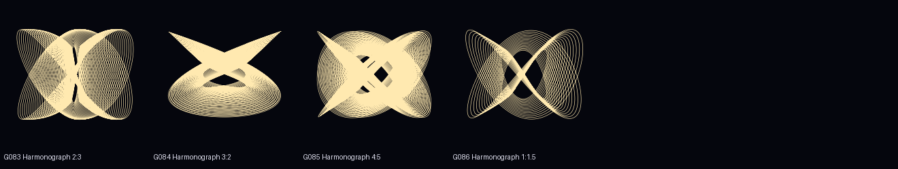

| ID | Name | Maths | Symmetry | File |
|---|---|---|---|---|
| G083 | Harmonograph 2:3 | Damped sum of sines, frequencies (2, 3, 2.01, 3.01) |  | [gobos_harmonographs.zip](../downloads/gobos_harmonographs.zip) `G083_harmonograph_2_3.stl` |
| G084 | Harmonograph 3:2 | Damped sum of sines, frequencies (3, 2, 3.003, 1.997) |  | [gobos_harmonographs.zip](../downloads/gobos_harmonographs.zip) `G084_harmonograph_3_2.stl` |
| G085 | Harmonograph 4:5 | Damped sum of sines, frequencies (4, 5, 4.002, 5.0) |  | [gobos_harmonographs.zip](../downloads/gobos_harmonographs.zip) `G085_harmonograph_4_5.stl` |
| G086 | Harmonograph 1:1.5 | Damped sum of sines, frequencies (1, 1.5, 1.003, 1.502) |  | [gobos_harmonographs.zip](../downloads/gobos_harmonographs.zip) `G086_harmonograph_1_1_5.stl` |

## Torus knots (p,q)

**Look:** Interwoven loops - trefoil, cinquefoil, star knots.

**Sources:** P.G. Tait knot tables (1876); Lord Kelvin's vortex atoms

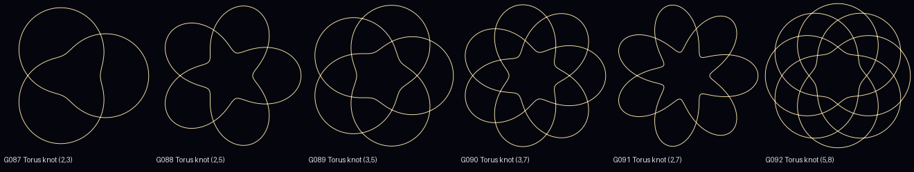

| ID | Name | Maths | Symmetry | File |
|---|---|---|---|---|
| G087 | Torus knot (2,3) | r = 2 + cos(3t), angle = 2t | D2 (dihedral, 2-fold) | [gobos_knots.zip](../downloads/gobos_knots.zip) `G087_torus_knot_2_3.stl` |
| G088 | Torus knot (2,5) | r = 2 + cos(5t), angle = 2t | D2 (dihedral, 2-fold) | [gobos_knots.zip](../downloads/gobos_knots.zip) `G088_torus_knot_2_5.stl` |
| G089 | Torus knot (3,5) | r = 2 + cos(5t), angle = 3t | D3 (dihedral, 3-fold) | [gobos_knots.zip](../downloads/gobos_knots.zip) `G089_torus_knot_3_5.stl` |
| G090 | Torus knot (3,7) | r = 2 + cos(7t), angle = 3t | D3 (dihedral, 3-fold) | [gobos_knots.zip](../downloads/gobos_knots.zip) `G090_torus_knot_3_7.stl` |
| G091 | Torus knot (2,7) | r = 2 + cos(7t), angle = 2t | D2 (dihedral, 2-fold) | [gobos_knots.zip](../downloads/gobos_knots.zip) `G091_torus_knot_2_7.stl` |
| G092 | Torus knot (5,8) | r = 2 + cos(8t), angle = 5t | D5 (dihedral, 5-fold) | [gobos_knots.zip](../downloads/gobos_knots.zip) `G092_torus_knot_5_8.stl` |

## Spirals & phyllotaxis

**Look:** Golden spiral, galaxy arms, sunflower seed heads - natural growth patterns.

**Sources:** Fibonacci (1202); Jakob Bernoulli 'spira mirabilis'; H. Vogel, Mathematical Biosciences 44 (1979)

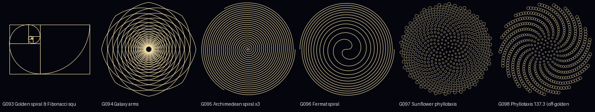

| ID | Name | Maths | Symmetry | File |
|---|---|---|---|---|
| G093 | Golden spiral & Fibonacci squares | Quarter-circle arcs in squares of side 1,1,2,3,5,8,... |  | [gobos_spirals.zip](../downloads/gobos_spirals.zip) `G093_golden_spiral_fibonacci_squares.stl` |
| G094 | Galaxy arms | 8 logarithmic spirals each way, r = e^(0.18 theta) | C8 | [gobos_spirals.zip](../downloads/gobos_spirals.zip) `G094_galaxy_arms.stl` |
| G095 | Archimedean spiral x3 | r = a theta, three arms | C3 | [gobos_spirals.zip](../downloads/gobos_spirals.zip) `G095_archimedean_spiral_x3.stl` |
| G096 | Fermat spiral | r = +-sqrt(theta) | C2 | [gobos_spirals.zip](../downloads/gobos_spirals.zip) `G096_fermat_spiral.stl` |
| G097 | Sunflower phyllotaxis | Vogel model: seed n at r = sqrt(n), angle n x 137.508 degrees (golden angle) |  | [gobos_spirals.zip](../downloads/gobos_spirals.zip) `G097_sunflower_phyllotaxis.stl` |
| G098 | Phyllotaxis 137.3 (off-golden) | Same with a slightly wrong angle: spokes appear |  | [gobos_spirals.zip](../downloads/gobos_spirals.zip) `G098_phyllotaxis_137_3_off_golden.stl` |

## Sacred & cultural geometry

**Look:** Interlaced circles and lattices with a ceremonial, meditative feel.

**Sources:** Flower of Life (Abydos, Egypt); Metatron's Cube; Borromean rings; taijitu; enneagram (Gurdjieff); yantra & mandala traditions

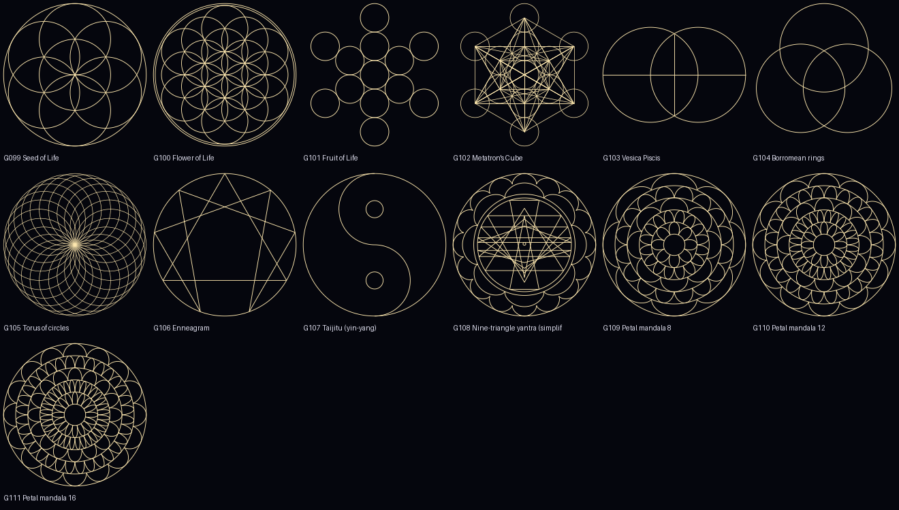

| ID | Name | Maths | Symmetry | File |
|---|---|---|---|---|
| G099 | Seed of Life | 7 equal circles, 6 centred on the first | D6 | [gobos_sacred.zip](../downloads/gobos_sacred.zip) `G099_seed_of_life.stl` |
| G100 | Flower of Life | 19 circles on a hexagonal lattice inside a bounding circle | D6 | [gobos_sacred.zip](../downloads/gobos_sacred.zip) `G100_flower_of_life.stl` |
| G101 | Fruit of Life | 13 circles: centre + two hex rings at 2r and 4r | D6 | [gobos_sacred.zip](../downloads/gobos_sacred.zip) `G101_fruit_of_life.stl` |
| G102 | Metatron's Cube | Fruit of Life with all 78 centre-to-centre lines | D6 | [gobos_sacred.zip](../downloads/gobos_sacred.zip) `G102_metatron_s_cube.stl` |
| G103 | Vesica Piscis | Two circles through each other's centres; ratio sqrt(3) | D2 | [gobos_sacred.zip](../downloads/gobos_sacred.zip) `G103_vesica_piscis.stl` |
| G104 | Borromean rings | Three circles, no two linked, all three inseparable | D3 | [gobos_sacred.zip](../downloads/gobos_sacred.zip) `G104_borromean_rings.stl` |
| G105 | Torus of circles | 24 circles through the centre (the 2D 'torus' figure) | D24 | [gobos_sacred.zip](../downloads/gobos_sacred.zip) `G105_torus_of_circles.stl` |
| G106 | Enneagram | Circle, triangle 3-6-9 and the 1-4-2-8-5-7 hexad (1/7 decimal cycle) |  | [gobos_sacred.zip](../downloads/gobos_sacred.zip) `G106_enneagram.stl` |
| G107 | Taijitu (yin-yang) | Circle split by two semicircles, with two eyes | C2 | [gobos_sacred.zip](../downloads/gobos_sacred.zip) `G107_taijitu_yin_yang.stl` |
| G108 | Nine-triangle yantra (simplified) | Four upward and five downward triangles with lotus rings - simplified, not canonical proportions | D1 | [gobos_sacred.zip](../downloads/gobos_sacred.zip) `G108_nine_triangle_yantra_simplified.stl` |
| G109 | Petal mandala 8 | Procedural petal rings, 8-fold | D8 (dihedral, 8-fold) | [gobos_sacred.zip](../downloads/gobos_sacred.zip) `G109_petal_mandala_8.stl` |
| G110 | Petal mandala 12 | Procedural petal rings, 12-fold | D12 (dihedral, 12-fold) | [gobos_sacred.zip](../downloads/gobos_sacred.zip) `G110_petal_mandala_12.stl` |
| G111 | Petal mandala 16 | Procedural petal rings, 16-fold | D16 (dihedral, 16-fold) | [gobos_sacred.zip](../downloads/gobos_sacred.zip) `G111_petal_mandala_16.stl` |

## Number patterns

**Look:** Mathematics made visible - cardioids appearing out of arithmetic, prime spirals.

**Sources:** Complete graphs ('mystic rose'); modular times tables (cardioid envelope); L.R. Ford, Am. Math. Monthly (1938); R. Sacks prime spiral (1994)

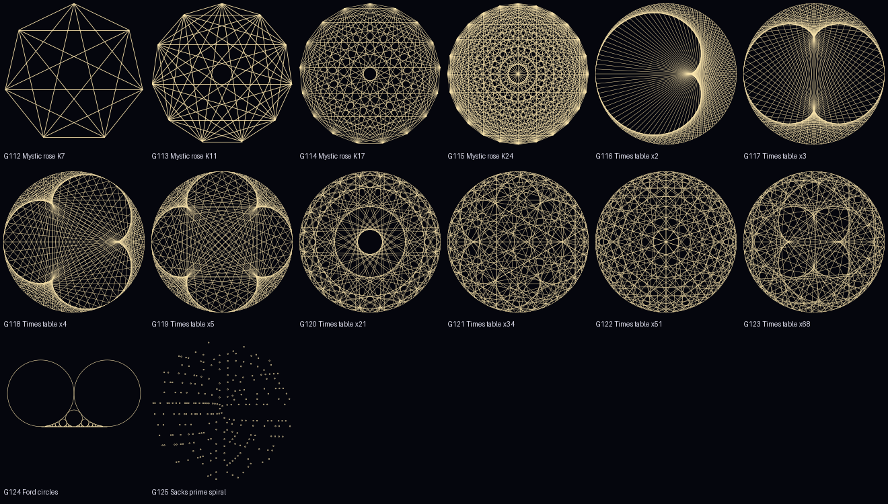

| ID | Name | Maths | Symmetry | File |
|---|---|---|---|---|
| G112 | Mystic rose K7 | Complete graph on 7 points of a circle (also the Petrie view of the 6-simplex) | D7 (dihedral, 7-fold) | [gobos_number.zip](../downloads/gobos_number.zip) `G112_mystic_rose_k7.stl` |
| G113 | Mystic rose K11 | Complete graph on 11 points of a circle (also the Petrie view of the 10-simplex) | D11 (dihedral, 11-fold) | [gobos_number.zip](../downloads/gobos_number.zip) `G113_mystic_rose_k11.stl` |
| G114 | Mystic rose K17 | Complete graph on 17 points of a circle (also the Petrie view of the 16-simplex) | D17 (dihedral, 17-fold) | [gobos_number.zip](../downloads/gobos_number.zip) `G114_mystic_rose_k17.stl` |
| G115 | Mystic rose K24 | Complete graph on 24 points of a circle (also the Petrie view of the 23-simplex) | D24 (dihedral, 24-fold) | [gobos_number.zip](../downloads/gobos_number.zip) `G115_mystic_rose_k24.stl` |
| G116 | Times table x2 | 180 points; join i to 2*i mod 180 (x2 cardioid, x3 nephroid) |  | [gobos_number.zip](../downloads/gobos_number.zip) `G116_times_table_x2.stl` |
| G117 | Times table x3 | 180 points; join i to 3*i mod 180 (x2 cardioid, x3 nephroid) |  | [gobos_number.zip](../downloads/gobos_number.zip) `G117_times_table_x3.stl` |
| G118 | Times table x4 | 180 points; join i to 4*i mod 180 (x2 cardioid, x3 nephroid) |  | [gobos_number.zip](../downloads/gobos_number.zip) `G118_times_table_x4.stl` |
| G119 | Times table x5 | 180 points; join i to 5*i mod 180 (x2 cardioid, x3 nephroid) |  | [gobos_number.zip](../downloads/gobos_number.zip) `G119_times_table_x5.stl` |
| G120 | Times table x21 | 180 points; join i to 21*i mod 180 (x2 cardioid, x3 nephroid) |  | [gobos_number.zip](../downloads/gobos_number.zip) `G120_times_table_x21.stl` |
| G121 | Times table x34 | 180 points; join i to 34*i mod 180 (x2 cardioid, x3 nephroid) |  | [gobos_number.zip](../downloads/gobos_number.zip) `G121_times_table_x34.stl` |
| G122 | Times table x51 | 180 points; join i to 51*i mod 180 (x2 cardioid, x3 nephroid) |  | [gobos_number.zip](../downloads/gobos_number.zip) `G122_times_table_x51.stl` |
| G123 | Times table x68 | 180 points; join i to 68*i mod 180 (x2 cardioid, x3 nephroid) |  | [gobos_number.zip](../downloads/gobos_number.zip) `G123_times_table_x68.stl` |
| G124 | Ford circles | Circle at p/q with radius 1/(2q^2): every rational, all tangent |  | [gobos_number.zip](../downloads/gobos_number.zip) `G124_ford_circles.stl` |
| G125 | Sacks prime spiral | Prime p at radius sqrt(p), angle 2 pi sqrt(p) |  | [gobos_number.zip](../downloads/gobos_number.zip) `G125_sacks_prime_spiral.stl` |

## Cosmic dance (real planetary periods)

**Look:** Orbital roses traced by real planets - the space-odyssey series.

**Sources:** NASA Planetary Fact Sheet sidereal periods; Venus 8-year pentagram (13 Venus orbits in 8 Earth years)

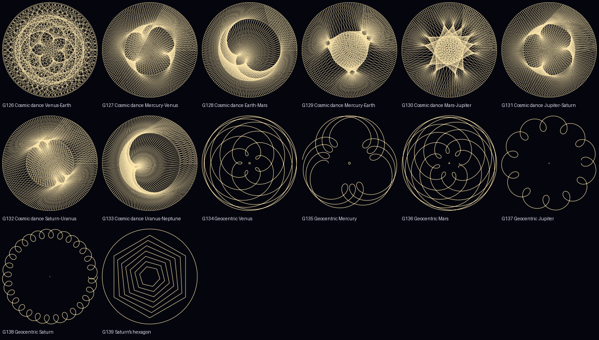

| ID | Name | Maths | Symmetry | File |
|---|---|---|---|---|
| G126 | Cosmic dance Venus-Earth | Lines between Venus and Earth at equal time steps (circular orbits, real periods) |  | [gobos_cosmic.zip](../downloads/gobos_cosmic.zip) `G126_cosmic_dance_venus_earth.stl` |
| G127 | Cosmic dance Mercury-Venus | Lines between Mercury and Venus at equal time steps (circular orbits, real periods) |  | [gobos_cosmic.zip](../downloads/gobos_cosmic.zip) `G127_cosmic_dance_mercury_venus.stl` |
| G128 | Cosmic dance Earth-Mars | Lines between Earth and Mars at equal time steps (circular orbits, real periods) |  | [gobos_cosmic.zip](../downloads/gobos_cosmic.zip) `G128_cosmic_dance_earth_mars.stl` |
| G129 | Cosmic dance Mercury-Earth | Lines between Mercury and Earth at equal time steps (circular orbits, real periods) |  | [gobos_cosmic.zip](../downloads/gobos_cosmic.zip) `G129_cosmic_dance_mercury_earth.stl` |
| G130 | Cosmic dance Mars-Jupiter | Lines between Mars and Jupiter at equal time steps (circular orbits, real periods) |  | [gobos_cosmic.zip](../downloads/gobos_cosmic.zip) `G130_cosmic_dance_mars_jupiter.stl` |
| G131 | Cosmic dance Jupiter-Saturn | Lines between Jupiter and Saturn at equal time steps (circular orbits, real periods) |  | [gobos_cosmic.zip](../downloads/gobos_cosmic.zip) `G131_cosmic_dance_jupiter_saturn.stl` |
| G132 | Cosmic dance Saturn-Uranus | Lines between Saturn and Uranus at equal time steps (circular orbits, real periods) |  | [gobos_cosmic.zip](../downloads/gobos_cosmic.zip) `G132_cosmic_dance_saturn_uranus.stl` |
| G133 | Cosmic dance Uranus-Neptune | Lines between Uranus and Neptune at equal time steps (circular orbits, real periods) |  | [gobos_cosmic.zip](../downloads/gobos_cosmic.zip) `G133_cosmic_dance_uranus_neptune.stl` |
| G134 | Geocentric Venus | Venus's path as seen from Earth over 8 years (retrograde loops) |  | [gobos_cosmic.zip](../downloads/gobos_cosmic.zip) `G134_geocentric_venus.stl` |
| G135 | Geocentric Mercury | Mercury's path as seen from Earth over 3 years (retrograde loops) |  | [gobos_cosmic.zip](../downloads/gobos_cosmic.zip) `G135_geocentric_mercury.stl` |
| G136 | Geocentric Mars | Mars's path as seen from Earth over 15 years (retrograde loops) |  | [gobos_cosmic.zip](../downloads/gobos_cosmic.zip) `G136_geocentric_mars.stl` |
| G137 | Geocentric Jupiter | Jupiter's path as seen from Earth over 12 years (retrograde loops) |  | [gobos_cosmic.zip](../downloads/gobos_cosmic.zip) `G137_geocentric_jupiter.stl` |
| G138 | Geocentric Saturn | Saturn's path as seen from Earth over 29.5 years (retrograde loops) |  | [gobos_cosmic.zip](../downloads/gobos_cosmic.zip) `G138_geocentric_saturn.stl` |
| G139 | Saturn's hexagon | Nested hexagonal jet stream at Saturn's north pole (Voyager 1981, Cassini) | C6 | [gobos_cosmic.zip](../downloads/gobos_cosmic.zip) `G139_saturn_s_hexagon.stl` |

## Cymatics & wave physics

**Look:** The patterns water itself makes - printed so the light can show them even when the water is still.

**Sources:** E. Chladni (1787); Lord Rayleigh, Theory of Sound (1877); M. Faraday (1831); W.S. Edwards & S. Fauve, Phys. Rev. E 47, R788 (1993); A. Kudrolli, B. Pier, J.P. Gollub, Physica D 123 (1998)

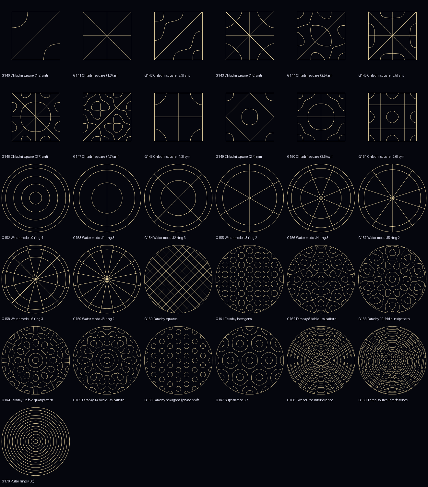

| ID | Name | Maths | Symmetry | File |
|---|---|---|---|---|
| G140 | Chladni square (1,2) anti | Nodal lines of cos(1pi x)cos(2pi y) - cos(2pi x)cos(1pi y) |  | [gobos_physics.zip](../downloads/gobos_physics.zip) `G140_chladni_square_1_2_anti.stl` |
| G141 | Chladni square (1,3) anti | Nodal lines of cos(1pi x)cos(3pi y) - cos(3pi x)cos(1pi y) |  | [gobos_physics.zip](../downloads/gobos_physics.zip) `G141_chladni_square_1_3_anti.stl` |
| G142 | Chladni square (2,3) anti | Nodal lines of cos(2pi x)cos(3pi y) - cos(3pi x)cos(2pi y) |  | [gobos_physics.zip](../downloads/gobos_physics.zip) `G142_chladni_square_2_3_anti.stl` |
| G143 | Chladni square (1,5) anti | Nodal lines of cos(1pi x)cos(5pi y) - cos(5pi x)cos(1pi y) |  | [gobos_physics.zip](../downloads/gobos_physics.zip) `G143_chladni_square_1_5_anti.stl` |
| G144 | Chladni square (2,5) anti | Nodal lines of cos(2pi x)cos(5pi y) - cos(5pi x)cos(2pi y) |  | [gobos_physics.zip](../downloads/gobos_physics.zip) `G144_chladni_square_2_5_anti.stl` |
| G145 | Chladni square (3,5) anti | Nodal lines of cos(3pi x)cos(5pi y) - cos(5pi x)cos(3pi y) |  | [gobos_physics.zip](../downloads/gobos_physics.zip) `G145_chladni_square_3_5_anti.stl` |
| G146 | Chladni square (3,7) anti | Nodal lines of cos(3pi x)cos(7pi y) - cos(7pi x)cos(3pi y) |  | [gobos_physics.zip](../downloads/gobos_physics.zip) `G146_chladni_square_3_7_anti.stl` |
| G147 | Chladni square (4,7) anti | Nodal lines of cos(4pi x)cos(7pi y) - cos(7pi x)cos(4pi y) |  | [gobos_physics.zip](../downloads/gobos_physics.zip) `G147_chladni_square_4_7_anti.stl` |
| G148 | Chladni square (1,3) sym | Nodal lines of cos(1pi x)cos(3pi y) + cos(3pi x)cos(1pi y) |  | [gobos_physics.zip](../downloads/gobos_physics.zip) `G148_chladni_square_1_3_sym.stl` |
| G149 | Chladni square (2,4) sym | Nodal lines of cos(2pi x)cos(4pi y) + cos(4pi x)cos(2pi y) |  | [gobos_physics.zip](../downloads/gobos_physics.zip) `G149_chladni_square_2_4_sym.stl` |
| G150 | Chladni square (3,5) sym | Nodal lines of cos(3pi x)cos(5pi y) + cos(5pi x)cos(3pi y) |  | [gobos_physics.zip](../downloads/gobos_physics.zip) `G150_chladni_square_3_5_sym.stl` |
| G151 | Chladni square (2,6) sym | Nodal lines of cos(2pi x)cos(6pi y) + cos(6pi x)cos(2pi y) |  | [gobos_physics.zip](../downloads/gobos_physics.zip) `G151_chladni_square_2_6_sym.stl` |
| G152 | Water mode J0 ring 4 | Nodal lines of J_0(k r) cos(0 theta), k from the 4th zero of J_0' (free edge) | D1 (dihedral, 1-fold) | [gobos_physics.zip](../downloads/gobos_physics.zip) `G152_water_mode_j0_ring_4.stl` |
| G153 | Water mode J1 ring 3 | Nodal lines of J_1(k r) cos(1 theta), k from the 3th zero of J_1' (free edge) | D2 (dihedral, 2-fold) | [gobos_physics.zip](../downloads/gobos_physics.zip) `G153_water_mode_j1_ring_3.stl` |
| G154 | Water mode J2 ring 3 | Nodal lines of J_2(k r) cos(2 theta), k from the 3th zero of J_2' (free edge) | D4 (dihedral, 4-fold) | [gobos_physics.zip](../downloads/gobos_physics.zip) `G154_water_mode_j2_ring_3.stl` |
| G155 | Water mode J3 ring 2 | Nodal lines of J_3(k r) cos(3 theta), k from the 2th zero of J_3' (free edge) | D6 (dihedral, 6-fold) | [gobos_physics.zip](../downloads/gobos_physics.zip) `G155_water_mode_j3_ring_2.stl` |
| G156 | Water mode J4 ring 3 | Nodal lines of J_4(k r) cos(4 theta), k from the 3th zero of J_4' (free edge) | D8 (dihedral, 8-fold) | [gobos_physics.zip](../downloads/gobos_physics.zip) `G156_water_mode_j4_ring_3.stl` |
| G157 | Water mode J5 ring 2 | Nodal lines of J_5(k r) cos(5 theta), k from the 2th zero of J_5' (free edge) | D10 (dihedral, 10-fold) | [gobos_physics.zip](../downloads/gobos_physics.zip) `G157_water_mode_j5_ring_2.stl` |
| G158 | Water mode J6 ring 3 | Nodal lines of J_6(k r) cos(6 theta), k from the 3th zero of J_6' (free edge) | D12 (dihedral, 12-fold) | [gobos_physics.zip](../downloads/gobos_physics.zip) `G158_water_mode_j6_ring_3.stl` |
| G159 | Water mode J8 ring 2 | Nodal lines of J_8(k r) cos(8 theta), k from the 2th zero of J_8' (free edge) | D16 (dihedral, 16-fold) | [gobos_physics.zip](../downloads/gobos_physics.zip) `G159_water_mode_j8_ring_2.stl` |
| G160 | Faraday squares | Zero contour of the sum of 2 standing plane waves at 90 degree steps | D4 | [gobos_physics.zip](../downloads/gobos_physics.zip) `G160_faraday_squares.stl` |
| G161 | Faraday hexagons | Zero contour of the sum of 3 standing plane waves at 60 degree steps | D6 | [gobos_physics.zip](../downloads/gobos_physics.zip) `G161_faraday_hexagons.stl` |
| G162 | Faraday 8-fold quasipattern | Zero contour of the sum of 4 standing plane waves at 45 degree steps | D8 | [gobos_physics.zip](../downloads/gobos_physics.zip) `G162_faraday_8_fold_quasipattern.stl` |
| G163 | Faraday 10-fold quasipattern | Zero contour of the sum of 5 standing plane waves at 36 degree steps | D10 | [gobos_physics.zip](../downloads/gobos_physics.zip) `G163_faraday_10_fold_quasipattern.stl` |
| G164 | Faraday 12-fold quasipattern | Zero contour of the sum of 6 standing plane waves at 30 degree steps | D12 | [gobos_physics.zip](../downloads/gobos_physics.zip) `G164_faraday_12_fold_quasipattern.stl` |
| G165 | Faraday 14-fold quasipattern | Zero contour of the sum of 7 standing plane waves at 25 degree steps | D14 | [gobos_physics.zip](../downloads/gobos_physics.zip) `G165_faraday_14_fold_quasipattern.stl` |
| G166 | Faraday hexagons (phase-shifted triangles) | Contour of 3-wave sum at 0.8 (triangles/hexagon cells) | D6 | [gobos_physics.zip](../downloads/gobos_physics.zip) `G166_faraday_hexagons_phase_shifted_triangles.stl` |
| G167 | Superlattice 6:7 | Two hexagonal wave sets at wavenumber ratio 7/6 (two-frequency forcing) |  | [gobos_physics.zip](../downloads/gobos_physics.zip) `G167_superlattice_6_7.stl` |
| G168 | Two-source interference | Crests of circular waves from two pins | D2 | [gobos_physics.zip](../downloads/gobos_physics.zip) `G168_two_source_interference.stl` |
| G169 | Three-source interference | Crests from three pins at 120 degrees | D3 | [gobos_physics.zip](../downloads/gobos_physics.zip) `G169_three_source_interference.stl` |
| G170 | Pulse rings (J0) | Zero contour of J0(k r): rings radiating from a centre pulse | O(2) | [gobos_physics.zip](../downloads/gobos_physics.zip) `G170_pulse_rings_j0.stl` |

## Optical elements

**Look:** Zone plates focus light into bright rings; line gratings make moire when two are stacked or rotated.

**Sources:** Fresnel zone plate (Fresnel 1818; Soret 1875); moire (Rayleigh 1874)

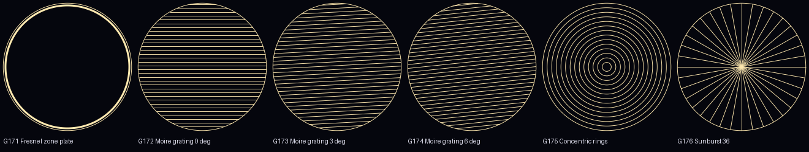

| ID | Name | Maths | Symmetry | File |
|---|---|---|---|---|
| G171 | Fresnel zone plate | Opaque zones between radii sqrt(k/N): focuses light like a lens |  | [gobos_optics.zip](../downloads/gobos_optics.zip) `G171_fresnel_zone_plate.stl` |
| G172 | Moire grating 0 deg | Parallel lines rotated 0 degrees - stack two for moire |  | [gobos_optics.zip](../downloads/gobos_optics.zip) `G172_moire_grating_0_deg.stl` |
| G173 | Moire grating 3 deg | Parallel lines rotated 3 degrees - stack two for moire |  | [gobos_optics.zip](../downloads/gobos_optics.zip) `G173_moire_grating_3_deg.stl` |
| G174 | Moire grating 6 deg | Parallel lines rotated 6 degrees - stack two for moire |  | [gobos_optics.zip](../downloads/gobos_optics.zip) `G174_moire_grating_6_deg.stl` |
| G175 | Concentric rings | 14 equally spaced circles (Newton-ring look) | O(2) | [gobos_optics.zip](../downloads/gobos_optics.zip) `G175_concentric_rings.stl` |
| G176 | Sunburst 36 | 36 radial spokes | D36 | [gobos_optics.zip](../downloads/gobos_optics.zip) `G176_sunburst_36.stl` |

## Archimedean tilings

**Look:** Endless honeycomb, kagome and octagon floors - wallpaper of light.

**Sources:** J. Kepler, Harmonices Mundi (1619); Wythoff construction (1918)

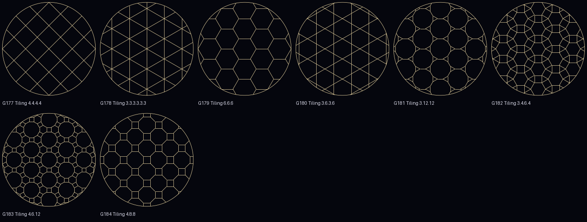

| ID | Name | Maths | Symmetry | File |
|---|---|---|---|---|
| G177 | Tiling 4.4.4.4 | Uniform tiling with vertex configuration 4.4.4.4, Wythoff construction |  | [gobos_tilings.zip](../downloads/gobos_tilings.zip) `G177_tiling_4_4_4_4.stl` |
| G178 | Tiling 3.3.3.3.3.3 | Uniform tiling with vertex configuration 3.3.3.3.3.3, Wythoff construction |  | [gobos_tilings.zip](../downloads/gobos_tilings.zip) `G178_tiling_3_3_3_3_3_3.stl` |
| G179 | Tiling 6.6.6 | Uniform tiling with vertex configuration 6.6.6, Wythoff construction |  | [gobos_tilings.zip](../downloads/gobos_tilings.zip) `G179_tiling_6_6_6.stl` |
| G180 | Tiling 3.6.3.6 | Uniform tiling with vertex configuration 3.6.3.6, Wythoff construction |  | [gobos_tilings.zip](../downloads/gobos_tilings.zip) `G180_tiling_3_6_3_6.stl` |
| G181 | Tiling 3.12.12 | Uniform tiling with vertex configuration 3.12.12, Wythoff construction |  | [gobos_tilings.zip](../downloads/gobos_tilings.zip) `G181_tiling_3_12_12.stl` |
| G182 | Tiling 3.4.6.4 | Uniform tiling with vertex configuration 3.4.6.4, Wythoff construction |  | [gobos_tilings.zip](../downloads/gobos_tilings.zip) `G182_tiling_3_4_6_4.stl` |
| G183 | Tiling 4.6.12 | Uniform tiling with vertex configuration 4.6.12, Wythoff construction |  | [gobos_tilings.zip](../downloads/gobos_tilings.zip) `G183_tiling_4_6_12.stl` |
| G184 | Tiling 4.8.8 | Uniform tiling with vertex configuration 4.8.8, Wythoff construction |  | [gobos_tilings.zip](../downloads/gobos_tilings.zip) `G184_tiling_4_8_8.stl` |

## Islamic star patterns (Hankin method)

**Look:** Interlocking rosettes and stars from the girih tradition, generated from tilings.

**Sources:** E.H. Hankin (1925); C.S. Kaplan, 'Islamic star patterns from polygons in contact', Graphics Interface (2005)

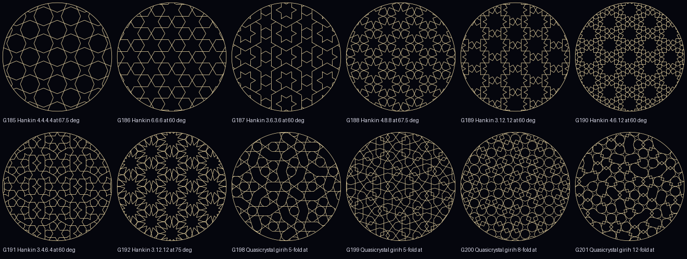

| ID | Name | Maths | Symmetry | File |
|---|---|---|---|---|
| G185 | Hankin 4.4.4.4 at 67.5 deg | Hankin rays at 67.5 degrees from edge midpoints of tiling 4.4.4.4 |  | [gobos_islamic.zip](../downloads/gobos_islamic.zip) `G185_hankin_4_4_4_4_at_67_5_deg.stl` |
| G186 | Hankin 6.6.6 at 60 deg | Hankin rays at 60 degrees from edge midpoints of tiling 6.6.6 |  | [gobos_islamic.zip](../downloads/gobos_islamic.zip) `G186_hankin_6_6_6_at_60_deg.stl` |
| G187 | Hankin 3.6.3.6 at 60 deg | Hankin rays at 60 degrees from edge midpoints of tiling 3.6.3.6 |  | [gobos_islamic.zip](../downloads/gobos_islamic.zip) `G187_hankin_3_6_3_6_at_60_deg.stl` |
| G188 | Hankin 4.8.8 at 67.5 deg | Hankin rays at 67.5 degrees from edge midpoints of tiling 4.8.8 |  | [gobos_islamic.zip](../downloads/gobos_islamic.zip) `G188_hankin_4_8_8_at_67_5_deg.stl` |
| G189 | Hankin 3.12.12 at 60 deg | Hankin rays at 60 degrees from edge midpoints of tiling 3.12.12 |  | [gobos_islamic.zip](../downloads/gobos_islamic.zip) `G189_hankin_3_12_12_at_60_deg.stl` |
| G190 | Hankin 4.6.12 at 60 deg | Hankin rays at 60 degrees from edge midpoints of tiling 4.6.12 |  | [gobos_islamic.zip](../downloads/gobos_islamic.zip) `G190_hankin_4_6_12_at_60_deg.stl` |
| G191 | Hankin 3.4.6.4 at 60 deg | Hankin rays at 60 degrees from edge midpoints of tiling 3.4.6.4 |  | [gobos_islamic.zip](../downloads/gobos_islamic.zip) `G191_hankin_3_4_6_4_at_60_deg.stl` |
| G192 | Hankin 3.12.12 at 75 deg | Hankin rays at 75 degrees from edge midpoints of tiling 3.12.12 |  | [gobos_islamic.zip](../downloads/gobos_islamic.zip) `G192_hankin_3_12_12_at_75_deg.stl` |
| G198 | Quasicrystal girih 5-fold at 72 deg | Hankin rays at 72 degrees on the 5-grid rhombus tiling |  | [gobos_islamic.zip](../downloads/gobos_islamic.zip) `G198_quasicrystal_girih_5_fold_at_72_deg.stl` |
| G199 | Quasicrystal girih 5-fold at 54 deg | Hankin rays at 54 degrees on the 5-grid rhombus tiling |  | [gobos_islamic.zip](../downloads/gobos_islamic.zip) `G199_quasicrystal_girih_5_fold_at_54_deg.stl` |
| G200 | Quasicrystal girih 8-fold at 67.5 deg | Hankin rays at 67.5 degrees on the 8-grid rhombus tiling |  | [gobos_islamic.zip](../downloads/gobos_islamic.zip) `G200_quasicrystal_girih_8_fold_at_67_5_deg.stl` |
| G201 | Quasicrystal girih 12-fold at 75 deg | Hankin rays at 75 degrees on the 12-grid rhombus tiling |  | [gobos_islamic.zip](../downloads/gobos_islamic.zip) `G201_quasicrystal_girih_12_fold_at_75_deg.stl` |

## Quasicrystal tilings (de Bruijn multigrid)

**Look:** Ordered but never repeating - 5-, 7-, 8- and 12-fold symmetry; matches the 12-fold quasipatterns two-frequency driving makes in water.

**Sources:** R. Penrose (1974); N.G. de Bruijn, Indagationes Math. 43 (1981); F. Beenker (1982); D. Shechtman (Nobel 2011)

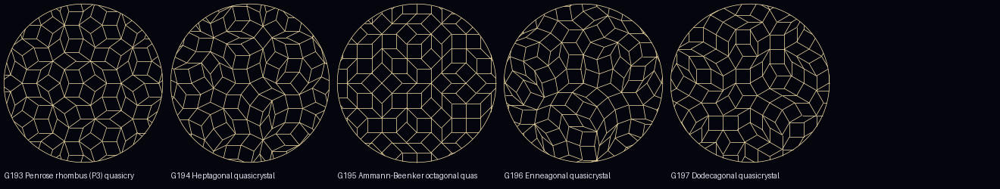

| ID | Name | Maths | Symmetry | File |
|---|---|---|---|---|
| G193 | Penrose rhombus (P3) quasicrystal | de Bruijn 5-grid dual tiling (rhombi) | 10-fold (statistical) | [gobos_quasicrystal.zip](../downloads/gobos_quasicrystal.zip) `G193_penrose_rhombus_p3_quasicrystal.stl` |
| G194 | Heptagonal quasicrystal | de Bruijn 7-grid dual tiling (rhombi) | 14-fold (statistical) | [gobos_quasicrystal.zip](../downloads/gobos_quasicrystal.zip) `G194_heptagonal_quasicrystal.stl` |
| G195 | Ammann-Beenker octagonal quasicrystal | de Bruijn 8-grid dual tiling (rhombi) | 8-fold (statistical) | [gobos_quasicrystal.zip](../downloads/gobos_quasicrystal.zip) `G195_ammann_beenker_octagonal_quasicrystal.stl` |
| G196 | Enneagonal quasicrystal | de Bruijn 9-grid dual tiling (rhombi) | 18-fold (statistical) | [gobos_quasicrystal.zip](../downloads/gobos_quasicrystal.zip) `G196_enneagonal_quasicrystal.stl` |
| G197 | Dodecagonal quasicrystal | de Bruijn 12-grid dual tiling (rhombi) | 12-fold (statistical) | [gobos_quasicrystal.zip](../downloads/gobos_quasicrystal.zip) `G197_dodecagonal_quasicrystal.stl` |

## Hyperbolic tilings {p,q} (Poincare disc)

**Look:** Tiles that shrink forever toward the rim - an infinite universe in a circle.

**Sources:** H. Poincare; H.S.M. Coxeter (1957); M.C. Escher, Circle Limit I-IV (1958-60)

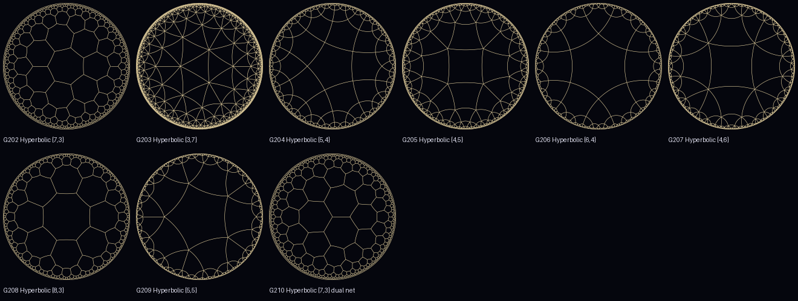

| ID | Name | Maths | Symmetry | File |
|---|---|---|---|---|
| G202 | Hyperbolic {7,3} | Regular tiling by 7-gons, 3 at each vertex, in the Poincare disc | D7 (dihedral, 7-fold) | [gobos_hyperbolic.zip](../downloads/gobos_hyperbolic.zip) `G202_hyperbolic_7_3.stl` |
| G203 | Hyperbolic {3,7} | Regular tiling by 3-gons, 7 at each vertex, in the Poincare disc | D3 (dihedral, 3-fold) | [gobos_hyperbolic.zip](../downloads/gobos_hyperbolic.zip) `G203_hyperbolic_3_7.stl` |
| G204 | Hyperbolic {5,4} | Regular tiling by 5-gons, 4 at each vertex, in the Poincare disc | D5 (dihedral, 5-fold) | [gobos_hyperbolic.zip](../downloads/gobos_hyperbolic.zip) `G204_hyperbolic_5_4.stl` |
| G205 | Hyperbolic {4,5} | Regular tiling by 4-gons, 5 at each vertex, in the Poincare disc | D4 (dihedral, 4-fold) | [gobos_hyperbolic.zip](../downloads/gobos_hyperbolic.zip) `G205_hyperbolic_4_5.stl` |
| G206 | Hyperbolic {6,4} | Regular tiling by 6-gons, 4 at each vertex, in the Poincare disc | D6 (dihedral, 6-fold) | [gobos_hyperbolic.zip](../downloads/gobos_hyperbolic.zip) `G206_hyperbolic_6_4.stl` |
| G207 | Hyperbolic {4,6} | Regular tiling by 4-gons, 6 at each vertex, in the Poincare disc | D4 (dihedral, 4-fold) | [gobos_hyperbolic.zip](../downloads/gobos_hyperbolic.zip) `G207_hyperbolic_4_6.stl` |
| G208 | Hyperbolic {8,3} | Regular tiling by 8-gons, 3 at each vertex, in the Poincare disc | D8 (dihedral, 8-fold) | [gobos_hyperbolic.zip](../downloads/gobos_hyperbolic.zip) `G208_hyperbolic_8_3.stl` |
| G209 | Hyperbolic {5,5} | Regular tiling by 5-gons, 5 at each vertex, in the Poincare disc | D5 (dihedral, 5-fold) | [gobos_hyperbolic.zip](../downloads/gobos_hyperbolic.zip) `G209_hyperbolic_5_5.stl` |
| G210 | Hyperbolic {7,3} dual net | Centres of {3,7} triangles joined (equivalent to {7,3}) | D7 | [gobos_hyperbolic.zip](../downloads/gobos_hyperbolic.zip) `G210_hyperbolic_7_3_dual_net.stl` |

## Platonic solids (3 views each)

**Look:** Wireframe shadows of the five perfect solids, seen down vertex, edge and face axes.

**Sources:** Plato, Timaeus; Euclid, Elements XIII

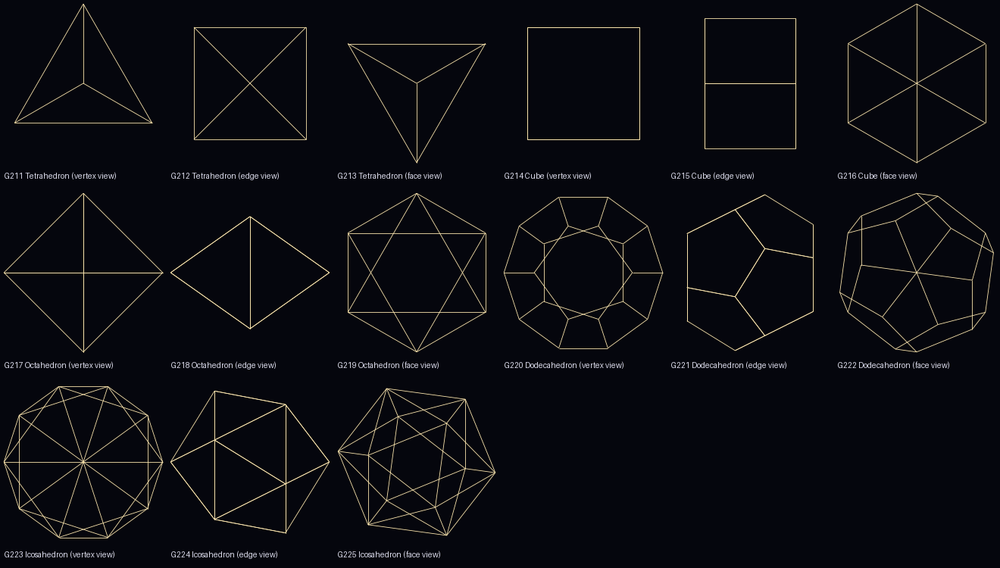

| ID | Name | Maths | Symmetry | File |
|---|---|---|---|---|
| G211 | Tetrahedron (vertex view) | Orthographic wireframe of the tetrahedron along a vertex-centre axis |  | [gobos_platonic.zip](../downloads/gobos_platonic.zip) `G211_tetrahedron_vertex_view.stl` |
| G212 | Tetrahedron (edge view) | Orthographic wireframe of the tetrahedron along a edge-centre axis |  | [gobos_platonic.zip](../downloads/gobos_platonic.zip) `G212_tetrahedron_edge_view.stl` |
| G213 | Tetrahedron (face view) | Orthographic wireframe of the tetrahedron along a face-centre axis |  | [gobos_platonic.zip](../downloads/gobos_platonic.zip) `G213_tetrahedron_face_view.stl` |
| G214 | Cube (vertex view) | Orthographic wireframe of the cube along a vertex-centre axis |  | [gobos_platonic.zip](../downloads/gobos_platonic.zip) `G214_cube_vertex_view.stl` |
| G215 | Cube (edge view) | Orthographic wireframe of the cube along a edge-centre axis |  | [gobos_platonic.zip](../downloads/gobos_platonic.zip) `G215_cube_edge_view.stl` |
| G216 | Cube (face view) | Orthographic wireframe of the cube along a face-centre axis |  | [gobos_platonic.zip](../downloads/gobos_platonic.zip) `G216_cube_face_view.stl` |
| G217 | Octahedron (vertex view) | Orthographic wireframe of the octahedron along a vertex-centre axis |  | [gobos_platonic.zip](../downloads/gobos_platonic.zip) `G217_octahedron_vertex_view.stl` |
| G218 | Octahedron (edge view) | Orthographic wireframe of the octahedron along a edge-centre axis |  | [gobos_platonic.zip](../downloads/gobos_platonic.zip) `G218_octahedron_edge_view.stl` |
| G219 | Octahedron (face view) | Orthographic wireframe of the octahedron along a face-centre axis |  | [gobos_platonic.zip](../downloads/gobos_platonic.zip) `G219_octahedron_face_view.stl` |
| G220 | Dodecahedron (vertex view) | Orthographic wireframe of the dodecahedron along a vertex-centre axis |  | [gobos_platonic.zip](../downloads/gobos_platonic.zip) `G220_dodecahedron_vertex_view.stl` |
| G221 | Dodecahedron (edge view) | Orthographic wireframe of the dodecahedron along a edge-centre axis |  | [gobos_platonic.zip](../downloads/gobos_platonic.zip) `G221_dodecahedron_edge_view.stl` |
| G222 | Dodecahedron (face view) | Orthographic wireframe of the dodecahedron along a face-centre axis |  | [gobos_platonic.zip](../downloads/gobos_platonic.zip) `G222_dodecahedron_face_view.stl` |
| G223 | Icosahedron (vertex view) | Orthographic wireframe of the icosahedron along a vertex-centre axis |  | [gobos_platonic.zip](../downloads/gobos_platonic.zip) `G223_icosahedron_vertex_view.stl` |
| G224 | Icosahedron (edge view) | Orthographic wireframe of the icosahedron along a edge-centre axis |  | [gobos_platonic.zip](../downloads/gobos_platonic.zip) `G224_icosahedron_edge_view.stl` |
| G225 | Icosahedron (face view) | Orthographic wireframe of the icosahedron along a face-centre axis |  | [gobos_platonic.zip](../downloads/gobos_platonic.zip) `G225_icosahedron_face_view.stl` |

## Archimedean solids

**Look:** Faceted spheres - soccer ball, snub cube, great rhombicosidodecahedron - as lace.

**Sources:** Archimedes (via Pappus); J. Kepler (1619); M. Wenninger, Polyhedron Models (1971)

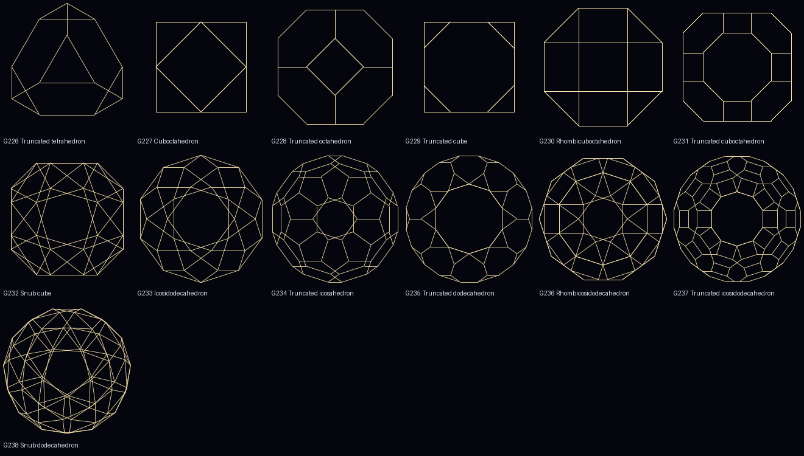

| ID | Name | Maths | Symmetry | File |
|---|---|---|---|---|
| G226 | Truncated tetrahedron | Wythoff construction (snubs by solving for equal edges); view down the highest-order axis |  | [gobos_archimedean.zip](../downloads/gobos_archimedean.zip) `G226_truncated_tetrahedron.stl` |
| G227 | Cuboctahedron | Wythoff construction (snubs by solving for equal edges); view down the highest-order axis |  | [gobos_archimedean.zip](../downloads/gobos_archimedean.zip) `G227_cuboctahedron.stl` |
| G228 | Truncated octahedron | Wythoff construction (snubs by solving for equal edges); view down the highest-order axis |  | [gobos_archimedean.zip](../downloads/gobos_archimedean.zip) `G228_truncated_octahedron.stl` |
| G229 | Truncated cube | Wythoff construction (snubs by solving for equal edges); view down the highest-order axis |  | [gobos_archimedean.zip](../downloads/gobos_archimedean.zip) `G229_truncated_cube.stl` |
| G230 | Rhombicuboctahedron | Wythoff construction (snubs by solving for equal edges); view down the highest-order axis |  | [gobos_archimedean.zip](../downloads/gobos_archimedean.zip) `G230_rhombicuboctahedron.stl` |
| G231 | Truncated cuboctahedron | Wythoff construction (snubs by solving for equal edges); view down the highest-order axis |  | [gobos_archimedean.zip](../downloads/gobos_archimedean.zip) `G231_truncated_cuboctahedron.stl` |
| G232 | Snub cube | Wythoff construction (snubs by solving for equal edges); view down the highest-order axis |  | [gobos_archimedean.zip](../downloads/gobos_archimedean.zip) `G232_snub_cube.stl` |
| G233 | Icosidodecahedron | Wythoff construction (snubs by solving for equal edges); view down the highest-order axis |  | [gobos_archimedean.zip](../downloads/gobos_archimedean.zip) `G233_icosidodecahedron.stl` |
| G234 | Truncated icosahedron | Wythoff construction (snubs by solving for equal edges); view down the highest-order axis |  | [gobos_archimedean.zip](../downloads/gobos_archimedean.zip) `G234_truncated_icosahedron.stl` |
| G235 | Truncated dodecahedron | Wythoff construction (snubs by solving for equal edges); view down the highest-order axis |  | [gobos_archimedean.zip](../downloads/gobos_archimedean.zip) `G235_truncated_dodecahedron.stl` |
| G236 | Rhombicosidodecahedron | Wythoff construction (snubs by solving for equal edges); view down the highest-order axis |  | [gobos_archimedean.zip](../downloads/gobos_archimedean.zip) `G236_rhombicosidodecahedron.stl` |
| G237 | Truncated icosidodecahedron | Wythoff construction (snubs by solving for equal edges); view down the highest-order axis |  | [gobos_archimedean.zip](../downloads/gobos_archimedean.zip) `G237_truncated_icosidodecahedron.stl` |
| G238 | Snub dodecahedron | Wythoff construction (snubs by solving for equal edges); view down the highest-order axis |  | [gobos_archimedean.zip](../downloads/gobos_archimedean.zip) `G238_snub_dodecahedron.stl` |

## Catalan solids (Archimedean duals)

**Look:** Star-burst duals of the Archimedean solids; dense radiating webs.

**Sources:** E. Catalan (1865)

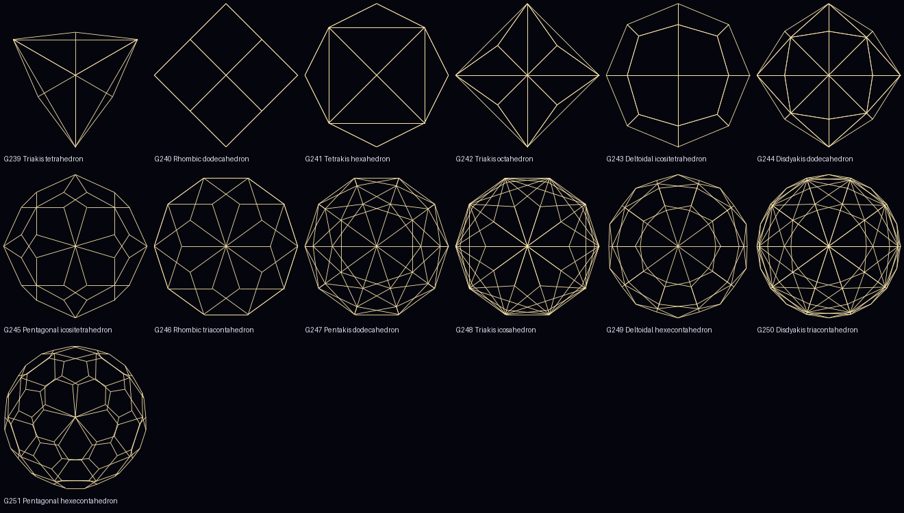

| ID | Name | Maths | Symmetry | File |
|---|---|---|---|---|
| G239 | Triakis tetrahedron | Polar dual of the truncated tetrahedron |  | [gobos_catalan.zip](../downloads/gobos_catalan.zip) `G239_triakis_tetrahedron.stl` |
| G240 | Rhombic dodecahedron | Polar dual of the cuboctahedron |  | [gobos_catalan.zip](../downloads/gobos_catalan.zip) `G240_rhombic_dodecahedron.stl` |
| G241 | Tetrakis hexahedron | Polar dual of the truncated octahedron |  | [gobos_catalan.zip](../downloads/gobos_catalan.zip) `G241_tetrakis_hexahedron.stl` |
| G242 | Triakis octahedron | Polar dual of the truncated cube |  | [gobos_catalan.zip](../downloads/gobos_catalan.zip) `G242_triakis_octahedron.stl` |
| G243 | Deltoidal icositetrahedron | Polar dual of the rhombicuboctahedron |  | [gobos_catalan.zip](../downloads/gobos_catalan.zip) `G243_deltoidal_icositetrahedron.stl` |
| G244 | Disdyakis dodecahedron | Polar dual of the truncated cuboctahedron |  | [gobos_catalan.zip](../downloads/gobos_catalan.zip) `G244_disdyakis_dodecahedron.stl` |
| G245 | Pentagonal icositetrahedron | Polar dual of the snub cube |  | [gobos_catalan.zip](../downloads/gobos_catalan.zip) `G245_pentagonal_icositetrahedron.stl` |
| G246 | Rhombic triacontahedron | Polar dual of the icosidodecahedron |  | [gobos_catalan.zip](../downloads/gobos_catalan.zip) `G246_rhombic_triacontahedron.stl` |
| G247 | Pentakis dodecahedron | Polar dual of the truncated icosahedron |  | [gobos_catalan.zip](../downloads/gobos_catalan.zip) `G247_pentakis_dodecahedron.stl` |
| G248 | Triakis icosahedron | Polar dual of the truncated dodecahedron |  | [gobos_catalan.zip](../downloads/gobos_catalan.zip) `G248_triakis_icosahedron.stl` |
| G249 | Deltoidal hexecontahedron | Polar dual of the rhombicosidodecahedron |  | [gobos_catalan.zip](../downloads/gobos_catalan.zip) `G249_deltoidal_hexecontahedron.stl` |
| G250 | Disdyakis triacontahedron | Polar dual of the truncated icosidodecahedron |  | [gobos_catalan.zip](../downloads/gobos_catalan.zip) `G250_disdyakis_triacontahedron.stl` |
| G251 | Pentagonal hexecontahedron | Polar dual of the snub dodecahedron |  | [gobos_catalan.zip](../downloads/gobos_catalan.zip) `G251_pentagonal_hexecontahedron.stl` |

## Kepler-Poinsot solids & compounds

**Look:** Star solids and interpenetrating compounds - sharp, crystalline, cathedral-like.

**Sources:** J. Kepler (1619); L. Poinsot (1809); E. Hess (1876); M.C. Escher 'Waterfall' (1961)

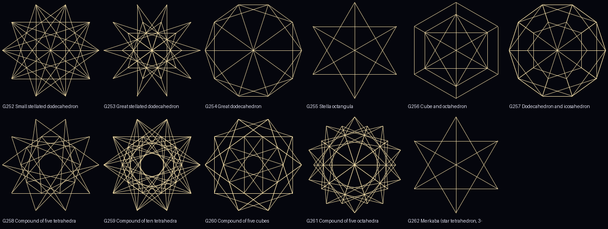

| ID | Name | Maths | Symmetry | File |
|---|---|---|---|---|
| G252 | Small stellated dodecahedron | Kepler-Poinsot star polyhedron edge skeleton (the great icosahedron shares the first's skeleton) |  | [gobos_stellated.zip](../downloads/gobos_stellated.zip) `G252_small_stellated_dodecahedron.stl` |
| G253 | Great stellated dodecahedron | Kepler-Poinsot star polyhedron edge skeleton (the great icosahedron shares the first's skeleton) |  | [gobos_stellated.zip](../downloads/gobos_stellated.zip) `G253_great_stellated_dodecahedron.stl` |
| G254 | Great dodecahedron | Kepler-Poinsot star polyhedron edge skeleton (the great icosahedron shares the first's skeleton) |  | [gobos_stellated.zip](../downloads/gobos_stellated.zip) `G254_great_dodecahedron.stl` |
| G255 | Stella octangula | Polyhedron compound generated by the symmetry group |  | [gobos_stellated.zip](../downloads/gobos_stellated.zip) `G255_stella_octangula.stl` |
| G256 | Cube and octahedron | Polyhedron compound generated by the symmetry group |  | [gobos_stellated.zip](../downloads/gobos_stellated.zip) `G256_cube_and_octahedron.stl` |
| G257 | Dodecahedron and icosahedron | Polyhedron compound generated by the symmetry group |  | [gobos_stellated.zip](../downloads/gobos_stellated.zip) `G257_dodecahedron_and_icosahedron.stl` |
| G258 | Compound of five tetrahedra | Polyhedron compound generated by the symmetry group |  | [gobos_stellated.zip](../downloads/gobos_stellated.zip) `G258_compound_of_five_tetrahedra.stl` |
| G259 | Compound of ten tetrahedra | Polyhedron compound generated by the symmetry group |  | [gobos_stellated.zip](../downloads/gobos_stellated.zip) `G259_compound_of_ten_tetrahedra.stl` |
| G260 | Compound of five cubes | Polyhedron compound generated by the symmetry group |  | [gobos_stellated.zip](../downloads/gobos_stellated.zip) `G260_compound_of_five_cubes.stl` |
| G261 | Compound of five octahedra | Polyhedron compound generated by the symmetry group |  | [gobos_stellated.zip](../downloads/gobos_stellated.zip) `G261_compound_of_five_octahedra.stl` |
| G262 | Merkaba (star tetrahedron, 3-fold) | Stella octangula seen down a body diagonal | D6 | [gobos_stellated.zip](../downloads/gobos_stellated.zip) `G262_merkaba_star_tetrahedron_3_fold.stl` |

## 4D+ polytopes in Coxeter planes

**Look:** Shadows of higher-dimensional objects - tesseract, 600-cell, 120-cell, and E8's famous 30-fold rose.

**Sources:** L. Schlaefli (1852); H.S.M. Coxeter, Regular Polytopes (1973); T. Gosset (1900); P. McMullen (E8 drawing)

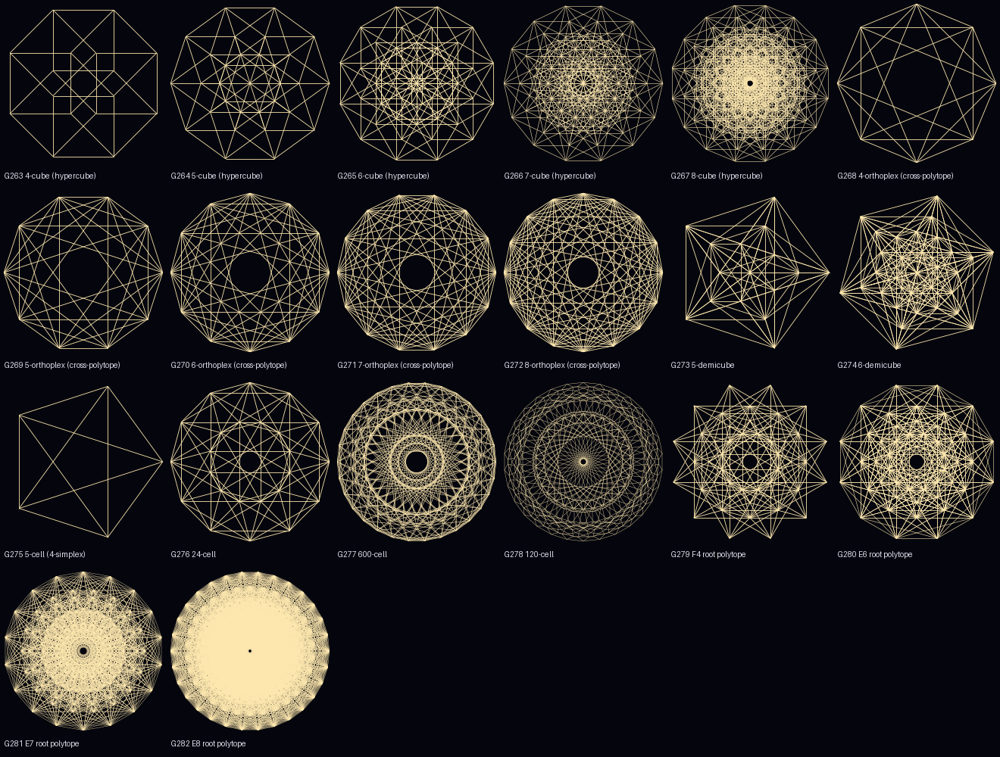

| ID | Name | Maths | Symmetry | File |
|---|---|---|---|---|
| G263 | 4-cube (hypercube) | 16 vertices of the 4-cube in the B4 Coxeter plane | D8 | [gobos_polytopes4d.zip](../downloads/gobos_polytopes4d.zip) `G263_4_cube_hypercube.stl` |
| G264 | 5-cube (hypercube) | 32 vertices of the 5-cube in the B5 Coxeter plane | D10 | [gobos_polytopes4d.zip](../downloads/gobos_polytopes4d.zip) `G264_5_cube_hypercube.stl` |
| G265 | 6-cube (hypercube) | 64 vertices of the 6-cube in the B6 Coxeter plane | D12 | [gobos_polytopes4d.zip](../downloads/gobos_polytopes4d.zip) `G265_6_cube_hypercube.stl` |
| G266 | 7-cube (hypercube) | 128 vertices of the 7-cube in the B7 Coxeter plane | D14 | [gobos_polytopes4d.zip](../downloads/gobos_polytopes4d.zip) `G266_7_cube_hypercube.stl` |
| G267 | 8-cube (hypercube) | 256 vertices of the 8-cube in the B8 Coxeter plane | D16 | [gobos_polytopes4d.zip](../downloads/gobos_polytopes4d.zip) `G267_8_cube_hypercube.stl` |
| G268 | 4-orthoplex (cross-polytope) | 8 vertices of the 4-dimensional cross-polytope | D8 | [gobos_polytopes4d.zip](../downloads/gobos_polytopes4d.zip) `G268_4_orthoplex_cross_polytope.stl` |
| G269 | 5-orthoplex (cross-polytope) | 10 vertices of the 5-dimensional cross-polytope | D10 | [gobos_polytopes4d.zip](../downloads/gobos_polytopes4d.zip) `G269_5_orthoplex_cross_polytope.stl` |
| G270 | 6-orthoplex (cross-polytope) | 12 vertices of the 6-dimensional cross-polytope | D12 | [gobos_polytopes4d.zip](../downloads/gobos_polytopes4d.zip) `G270_6_orthoplex_cross_polytope.stl` |
| G271 | 7-orthoplex (cross-polytope) | 14 vertices of the 7-dimensional cross-polytope | D14 | [gobos_polytopes4d.zip](../downloads/gobos_polytopes4d.zip) `G271_7_orthoplex_cross_polytope.stl` |
| G272 | 8-orthoplex (cross-polytope) | 16 vertices of the 8-dimensional cross-polytope | D16 | [gobos_polytopes4d.zip](../downloads/gobos_polytopes4d.zip) `G272_8_orthoplex_cross_polytope.stl` |
| G273 | 5-demicube | Alternated 5-cube | D10 | [gobos_polytopes4d.zip](../downloads/gobos_polytopes4d.zip) `G273_5_demicube.stl` |
| G274 | 6-demicube | Alternated 6-cube | D12 | [gobos_polytopes4d.zip](../downloads/gobos_polytopes4d.zip) `G274_6_demicube.stl` |
| G275 | 5-cell (4-simplex) | Regular 4-simplex; Petrie polygon is a pentagon | D5 | [gobos_polytopes4d.zip](../downloads/gobos_polytopes4d.zip) `G275_5_cell_4_simplex.stl` |
| G276 | 24-cell | 24 unit Hurwitz quaternions; Coxeter plane of F4 (12-fold) | D12 | [gobos_polytopes4d.zip](../downloads/gobos_polytopes4d.zip) `G276_24_cell.stl` |
| G277 | 600-cell | 120 unit icosians (binary icosahedral group); H4 Coxeter plane (30-fold) | D30 | [gobos_polytopes4d.zip](../downloads/gobos_polytopes4d.zip) `G277_600_cell.stl` |
| G278 | 120-cell | 600 cell-centres of the 600-cell; H4 Coxeter plane | D30 | [gobos_polytopes4d.zip](../downloads/gobos_polytopes4d.zip) `G278_120_cell.stl` |
| G279 | F4 root polytope | 48 roots of F4 projected to its Coxeter plane |  | [gobos_polytopes4d.zip](../downloads/gobos_polytopes4d.zip) `G279_f4_root_polytope.stl` |
| G280 | E6 root polytope | 72 roots of E6 projected to its Coxeter plane |  | [gobos_polytopes4d.zip](../downloads/gobos_polytopes4d.zip) `G280_e6_root_polytope.stl` |
| G281 | E7 root polytope | 126 roots of E7 projected to its Coxeter plane |  | [gobos_polytopes4d.zip](../downloads/gobos_polytopes4d.zip) `G281_e7_root_polytope.stl` |
| G282 | E8 root polytope | 240 roots of E8 projected to its Coxeter plane (Gosset 4_21) |  | [gobos_polytopes4d.zip](../downloads/gobos_polytopes4d.zip) `G282_e8_root_polytope.stl` |

## Fractals & space-filling curves

**Look:** Self-similar detail at every scale - coastlines, snowflakes, ferns, Julia lace.

**Sources:** H. von Koch (1904); W. Sierpinski (1915-16); D. Hilbert (1891); G. Peano (1890); J. Heighway (1966); P. Levy (1938); W. Gosper (1973); T. Vicsek (1983); A. Lindenmayer (1968); G. Julia (1918); B. Mandelbrot (1980)

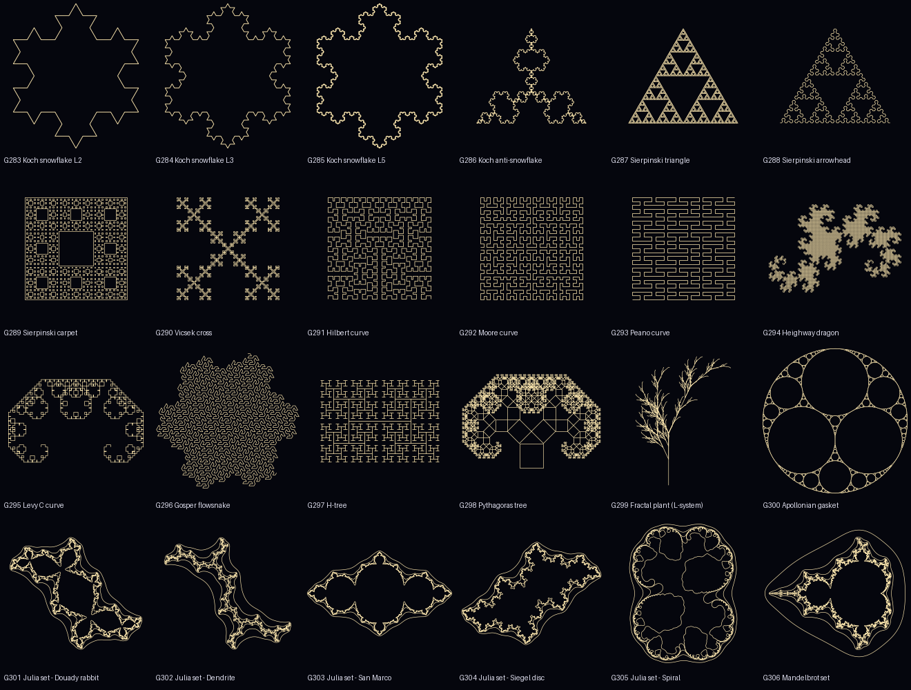

| ID | Name | Maths | Symmetry | File |
|---|---|---|---|---|
| G283 | Koch snowflake L2 | Koch curve x3, 2 iterations; perimeter grows (4/3)^n | D6 | [gobos_fractals.zip](../downloads/gobos_fractals.zip) `G283_koch_snowflake_l2.stl` |
| G284 | Koch snowflake L3 | Koch curve x3, 3 iterations; perimeter grows (4/3)^n | D6 | [gobos_fractals.zip](../downloads/gobos_fractals.zip) `G284_koch_snowflake_l3.stl` |
| G285 | Koch snowflake L5 | Koch curve x3, 5 iterations; perimeter grows (4/3)^n | D6 | [gobos_fractals.zip](../downloads/gobos_fractals.zip) `G285_koch_snowflake_l5.stl` |
| G286 | Koch anti-snowflake | Koch curve folded inward | D6 | [gobos_fractals.zip](../downloads/gobos_fractals.zip) `G286_koch_anti_snowflake.stl` |
| G287 | Sierpinski triangle | 6 levels of triangle subdivision (dimension log3/log2) | D3 | [gobos_fractals.zip](../downloads/gobos_fractals.zip) `G287_sierpinski_triangle.stl` |
| G288 | Sierpinski arrowhead | L-system arrowhead curve, order 6 | D3 | [gobos_fractals.zip](../downloads/gobos_fractals.zip) `G288_sierpinski_arrowhead.stl` |
| G289 | Sierpinski carpet | Remove the centre ninth, 4 levels | D4 | [gobos_fractals.zip](../downloads/gobos_fractals.zip) `G289_sierpinski_carpet.stl` |
| G290 | Vicsek cross | Keep the centre and corners, 4 levels | D4 | [gobos_fractals.zip](../downloads/gobos_fractals.zip) `G290_vicsek_cross.stl` |
| G291 | Hilbert curve | Space-filling curve, order 5 |  | [gobos_fractals.zip](../downloads/gobos_fractals.zip) `G291_hilbert_curve.stl` |
| G292 | Moore curve | Closed Hilbert variant, order 4 |  | [gobos_fractals.zip](../downloads/gobos_fractals.zip) `G292_moore_curve.stl` |
| G293 | Peano curve | Original space-filling curve, order 3 |  | [gobos_fractals.zip](../downloads/gobos_fractals.zip) `G293_peano_curve.stl` |
| G294 | Heighway dragon | Paper-folding dragon, 12 folds |  | [gobos_fractals.zip](../downloads/gobos_fractals.zip) `G294_heighway_dragon.stl` |
| G295 | Levy C curve | Levy C curve, order 10 |  | [gobos_fractals.zip](../downloads/gobos_fractals.zip) `G295_levy_c_curve.stl` |
| G296 | Gosper flowsnake | Peano-Gosper curve, order 4 |  | [gobos_fractals.zip](../downloads/gobos_fractals.zip) `G296_gosper_flowsnake.stl` |
| G297 | H-tree | Each segment branches into two at 1/sqrt(2) length | D2 | [gobos_fractals.zip](../downloads/gobos_fractals.zip) `G297_h_tree.stl` |
| G298 | Pythagoras tree | Squares on right isosceles triangles, 9 levels |  | [gobos_fractals.zip](../downloads/gobos_fractals.zip) `G298_pythagoras_tree.stl` |
| G299 | Fractal plant (L-system) | Lindenmayer fern-like plant, 5 generations |  | [gobos_fractals.zip](../downloads/gobos_fractals.zip) `G299_fractal_plant_l_system.stl` |
| G300 | Apollonian gasket | Descartes circle theorem (complex form) recursion | D3 | [gobos_fractals.zip](../downloads/gobos_fractals.zip) `G300_apollonian_gasket.stl` |
| G301 | Julia set - Douady rabbit | Escape-time contours of z -> z^2 + (-0.123+0.745i) |  | [gobos_fractals.zip](../downloads/gobos_fractals.zip) `G301_julia_set_douady_rabbit.stl` |
| G302 | Julia set - Dendrite | Escape-time contours of z -> z^2 + (+0.000+1.000i) |  | [gobos_fractals.zip](../downloads/gobos_fractals.zip) `G302_julia_set_dendrite.stl` |
| G303 | Julia set - San Marco | Escape-time contours of z -> z^2 + (-0.750+0.000i) |  | [gobos_fractals.zip](../downloads/gobos_fractals.zip) `G303_julia_set_san_marco.stl` |
| G304 | Julia set - Siegel disc | Escape-time contours of z -> z^2 + (-0.391-0.587i) |  | [gobos_fractals.zip](../downloads/gobos_fractals.zip) `G304_julia_set_siegel_disc.stl` |
| G305 | Julia set - Spiral | Escape-time contours of z -> z^2 + (+0.285+0.010i) |  | [gobos_fractals.zip](../downloads/gobos_fractals.zip) `G305_julia_set_spiral.stl` |
| G306 | Mandelbrot set | Escape-time contours of z -> z^2 + c |  | [gobos_fractals.zip](../downloads/gobos_fractals.zip) `G306_mandelbrot_set.stl` |

## Boundary inserts (the water's 'drum shape')

**Look:** Changes the standing-wave modes the water can make. Small dishes and low frequencies follow the wall shape; chaotic billiards scramble them into speckle.

**Sources:** Rayleigh (1877); Bunimovich (1979); Ya. Sinai (1970); M. Robnik (1983); B. Sapoval, fractal drums (1991); M. Kac, 'Can one hear the shape of a drum?' (1966)

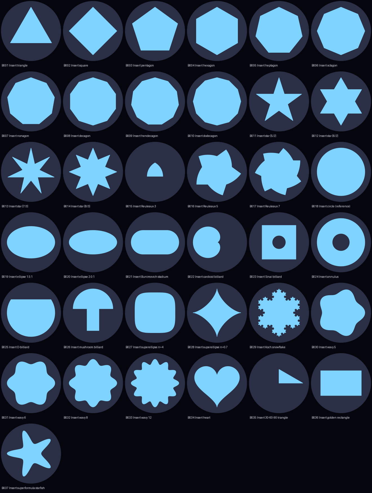

| ID | Name | Maths | Symmetry | File |
|---|---|---|---|---|
| B001 | Insert triangle | Regular 3-gon cavity |  | [stl](../stl/inserts/B001_insert_triangle.stl) |
| B002 | Insert square | Regular 4-gon cavity |  | [stl](../stl/inserts/B002_insert_square.stl) |
| B003 | Insert pentagon | Regular 5-gon cavity |  | [stl](../stl/inserts/B003_insert_pentagon.stl) |
| B004 | Insert hexagon | Regular 6-gon cavity |  | [stl](../stl/inserts/B004_insert_hexagon.stl) |
| B005 | Insert heptagon | Regular 7-gon cavity |  | [stl](../stl/inserts/B005_insert_heptagon.stl) |
| B006 | Insert octagon | Regular 8-gon cavity |  | [stl](../stl/inserts/B006_insert_octagon.stl) |
| B007 | Insert nonagon | Regular 9-gon cavity |  | [stl](../stl/inserts/B007_insert_nonagon.stl) |
| B008 | Insert decagon | Regular 10-gon cavity |  | [stl](../stl/inserts/B008_insert_decagon.stl) |
| B009 | Insert hendecagon | Regular 11-gon cavity |  | [stl](../stl/inserts/B009_insert_hendecagon.stl) |
| B010 | Insert dodecagon | Regular 12-gon cavity |  | [stl](../stl/inserts/B010_insert_dodecagon.stl) |
| B011 | Insert star {5/2} | Star {5/2} outline cavity |  | [stl](../stl/inserts/B011_insert_star_5_2.stl) |
| B012 | Insert star {6/2} | Star {6/2} outline cavity |  | [stl](../stl/inserts/B012_insert_star_6_2.stl) |
| B013 | Insert star {7/3} | Star {7/3} outline cavity |  | [stl](../stl/inserts/B013_insert_star_7_3.stl) |
| B014 | Insert star {8/3} | Star {8/3} outline cavity |  | [stl](../stl/inserts/B014_insert_star_8_3.stl) |
| B015 | Insert Reuleaux 3 | Reuleaux 3-gon: constant width |  | [stl](../stl/inserts/B015_insert_reuleaux_3.stl) |
| B016 | Insert Reuleaux 5 | Reuleaux 5-gon: constant width |  | [stl](../stl/inserts/B016_insert_reuleaux_5.stl) |
| B017 | Insert Reuleaux 7 | Reuleaux 7-gon: constant width |  | [stl](../stl/inserts/B017_insert_reuleaux_7.stl) |
| B018 | Insert circle (reference) | Circle: clean Bessel modes |  | [stl](../stl/inserts/B018_insert_circle_reference.stl) |
| B019 | Insert ellipse 1.5:1 | Ellipse with axis ratio 1.5 (integrable billiard) |  | [stl](../stl/inserts/B019_insert_ellipse_1_5_1.stl) |
| B020 | Insert ellipse 2.0:1 | Ellipse with axis ratio 2.0 (integrable billiard) |  | [stl](../stl/inserts/B020_insert_ellipse_2_0_1.stl) |
| B021 | Insert Bunimovich stadium | Two semicircles joined by straight sides (fully chaotic billiard) |  | [stl](../stl/inserts/B021_insert_bunimovich_stadium.stl) |
| B022 | Insert cardioid billiard | Cardioid (Robnik billiard, chaotic) |  | [stl](../stl/inserts/B022_insert_cardioid_billiard.stl) |
| B023 | Insert Sinai billiard | Square with a central disc obstacle (the post prints as a loose piece: glue it down) |  | [stl](../stl/inserts/B023_insert_sinai_billiard.stl) |
| B024 | Insert annulus | Ring channel (loose centre post) |  | [stl](../stl/inserts/B024_insert_annulus.stl) |
| B025 | Insert D-billiard | Circle with a flat cut (mixed regular/chaotic) |  | [stl](../stl/inserts/B025_insert_d_billiard.stl) |
| B026 | Insert mushroom billiard | Bunimovich mushroom: semicircle cap on a stem (separated chaos) |  | [stl](../stl/inserts/B026_insert_mushroom_billiard.stl) |
| B027 | Insert superellipse n=4 | /x/^4 + /y/^4 = 1 |  | [stl](../stl/inserts/B027_insert_superellipse_n_4.stl) |
| B028 | Insert superellipse n=0.7 | /x/^0.7 + /y/^0.7 = 1 |  | [stl](../stl/inserts/B028_insert_superellipse_n_0_7.stl) |
| B029 | Insert Koch snowflake | Koch level 3 fractal drum (Sapoval) |  | [stl](../stl/inserts/B029_insert_koch_snowflake.stl) |
| B030 | Insert wavy 5 | r = 1 + 0.12 cos(5 theta): seeds 5-fold modes |  | [stl](../stl/inserts/B030_insert_wavy_5.stl) |
| B031 | Insert wavy 6 | r = 1 + 0.12 cos(6 theta): seeds 6-fold modes |  | [stl](../stl/inserts/B031_insert_wavy_6.stl) |
| B032 | Insert wavy 8 | r = 1 + 0.12 cos(8 theta): seeds 8-fold modes |  | [stl](../stl/inserts/B032_insert_wavy_8.stl) |
| B033 | Insert wavy 12 | r = 1 + 0.12 cos(12 theta): seeds 12-fold modes |  | [stl](../stl/inserts/B033_insert_wavy_12.stl) |
| B034 | Insert heart | Heart curve |  | [stl](../stl/inserts/B034_insert_heart.stl) |
| B035 | Insert 30-60-90 triangle | Hemi-equilateral triangle (integrable, modes known exactly) |  | [stl](../stl/inserts/B035_insert_30_60_90_triangle.stl) |
| B036 | Insert golden rectangle | Rectangle with ratio phi |  | [stl](../stl/inserts/B036_insert_golden_rectangle.stl) |
| B037 | Insert superformula starfish | Gielis starfish outline |  | [stl](../stl/inserts/B037_insert_superformula_starfish.stl) |

## Dipper feet (wave sources)

**Look:** Shapes the wave that is pushed into the water: rings pulse outward from a point, two pins interfere, a triangle launches triangular wavefronts.

**Sources:** Thomas Young two-source interference (1801); ripple-tank practice

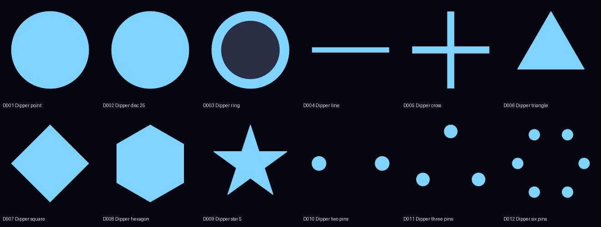

| ID | Name | Maths | Symmetry | File |
|---|---|---|---|---|
| D001 | Dipper point | 6 mm disc: a single point source - rings pulse outward |  | [stl](../stl/dippers/D001_dipper_point.stl) |
| D002 | Dipper disc 25 | 25 mm disc: stronger, smoother rings |  | [stl](../stl/dippers/D002_dipper_disc_25.stl) |
| D003 | Dipper ring | Ring: launches inward and outward waves that focus at the centre |  | [stl](../stl/dippers/D003_dipper_ring.stl) |
| D004 | Dipper line | Bar: plane waves to both sides |  | [stl](../stl/dippers/D004_dipper_line.stl) |
| D005 | Dipper cross | Cross: four plane-wave fronts |  | [stl](../stl/dippers/D005_dipper_cross.stl) |
| D006 | Dipper triangle | Triangle foot: 3-sided wavefronts |  | [stl](../stl/dippers/D006_dipper_triangle.stl) |
| D007 | Dipper square | Square foot: 4-sided wavefronts |  | [stl](../stl/dippers/D007_dipper_square.stl) |
| D008 | Dipper hexagon | Hexagon foot: 6-sided wavefronts |  | [stl](../stl/dippers/D008_dipper_hexagon.stl) |
| D009 | Dipper star 5 | Pentagram foot |  | [stl](../stl/dippers/D009_dipper_star_5.stl) |
| D010 | Dipper two pins | Two 4 mm pins 18 mm apart: Young's two-source interference |  | [stl](../stl/dippers/D010_dipper_two_pins.stl) |
| D011 | Dipper three pins | Three pins at 120 degrees: hexagonal interference |  | [stl](../stl/dippers/D011_dipper_three_pins.stl) |
| D012 | Dipper six pins | Six-pin ring: focused hexagonal standing waves |  | [stl](../stl/dippers/D012_dipper_six_pins.stl) |

## Hardware parts

| File | What it is |
|---|---|
| [stl/hardware/platform_4x_exciter.stl](../stl/hardware/platform_4x_exciter.stl) | Square vibration platform: 4 x Dayton DAEX32EP-4 exciters bond to the rings underneath; 128 mm light aperture; 152 mm recess for the glass dish. |
| [stl/hardware/platform_foot_cup.stl](../stl/hardware/platform_foot_cup.stl) | Cup for a 25 mm Sorbothane hemisphere; print 4. Lets the platform float so it can move. |
| [stl/hardware/dipper_arm.stl](../stl/hardware/dipper_arm.stl) | Offset arm: the 30 mm pad glues to a 3-4 in speaker's dust cap; the dipper stem drops through the far boss (M3 set screw). |
| [stl/hardware/led_cradle.stl](../stl/hardware/led_cradle.stl) | Holds a 40 x 40 mm heatsink with a 20 mm star LED, pointing up at the dish. |
| [stl/hardware/mirror_holder_45.stl](../stl/hardware/mirror_holder_45.stl) | Holds a 100 x 100 mm first-surface mirror at 45 degrees to throw the pattern onto a wall. |
| [stl/hardware/gobo_carrier.stl](../stl/hardware/gobo_carrier.stl) | Ring that sits under the dish and holds a 110 mm gobo or printed film. |
| [stl/hardware/lens_ring_80mm.stl](../stl/hardware/lens_ring_80mm.stl) | Holds an 80 mm, ~100 mm focal-length lens on three M5 rods above the dish; it images the caustics onto the wall (focus with the nuts). |
| [stl/hardware/platform_quarter_a1mini.stl](../stl/hardware/platform_quarter_a1mini.stl) | A1 mini version of the platform: print this quarter 4 times (it is symmetric), join with 4 splice plates and 16 x M3x12 + nuts. |
| [stl/hardware/platform_splice_plate.stl](../stl/hardware/platform_splice_plate.stl) | Splice plate for the A1-mini platform quarters (print 4). |
| [stl/hardware/panel_corner.stl](../stl/hardware/panel_corner.stl) | L-bracket for 3-5 mm acrylic enclosure panels (M3 screws). Print 8-12. |
| [stl/hardware/coil_bay_base.stl](../stl/hardware/coil_bay_base.stl) | Separate dry bay base for the EZ-100 Tesla coil (default 130 x 130 mm: measure yours). |
