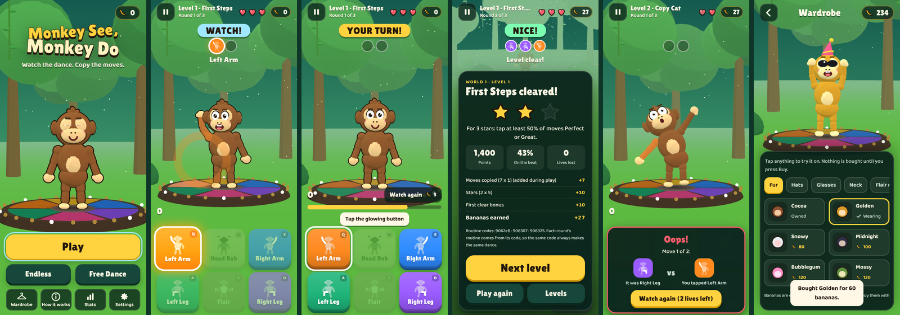
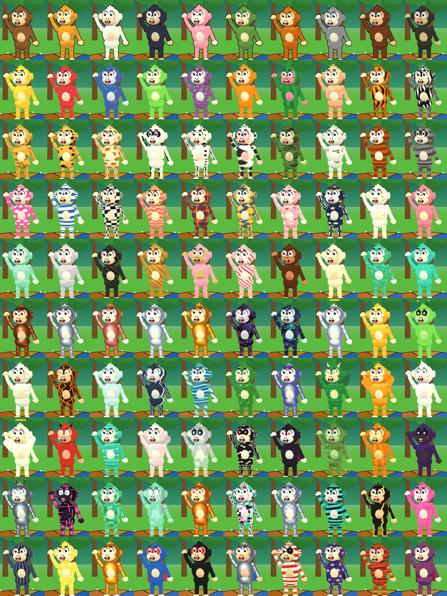

# Monkey See, Monkey Do

A casual rhythm-memory game for phones (and anything with a browser). A
cartoon 3D monkey dances a routine on the beat; you copy it, move for move,
in the same order. Built from `prompts/claude/monkey-see-monkey-do.md`.



## Play

- **Watch.** The monkey dances. Each move lights its button and its wedge of
  the dance floor and plays its own note (like the old colour-and-tone memory games).
- **Your turn.** Copy the routine before the timer runs out. Tap the buttons,
  tap the monkey's hands, feet, head or belly, swipe on the stage, or use the
  keyboard (`Q W E` / `A S D`, or `7 8 9` / `4 5 6`).
- **Cheer or oops.** Right: cheering, confetti, bananas, and a longer
  routine. Wrong (or out of time): a dizzy stumble, a card showing what the
  move was and what you tapped, one life gone, and the *same* routine again.

| Move | Button | Key | Swipe |
|---|---|---|---|
| Left Arm | orange, top left | Q / 7 | up-left |
| Head Bob | yellow, top middle | W / 8 | up |
| Right Arm | blue, top right | E / 9 | up-right |
| Left Leg | green, bottom left | A / 4 | down-left |
| Flair | pink, bottom middle | S / 5 | down |
| Right Leg | purple, bottom right | D / 6 | down-right |

Combos (from level 4): two moves at once, both within 320 ms (520 ms in Assist).
"Left" means the left of the screen, like a mirror. Settings can switch the
names to the monkey's own sides; the buttons never move.

## What's in it

- **Adventure:** 30 levels in 3 worlds (Jungle Clearing, Beach Bash, Temple
  Disco), 3 lives a level, 3 stars a level, boss levels 10/20/30.
  - Levels 1-3: 2-3 moves, 80-88 BPM. Levels 4-10: 4-6 moves, 95-120 BPM, combos.
  - World 2 adds build-up rounds (each round repeats the last and adds moves),
    cross combos, and speed-up rounds. World 3 adds backwards rounds, up to 10 moves at 142 BPM.
- **Endless:** classic memory loop. Starts at 2 moves, +1 each round, tempo
  rises to 160 BPM, one mistake ends it. Best is saved.
- **Free Dance:** tap anything, no score, no timer. Good for learning the moves.
- **100 skins** in 13 themed sets (see below), plus 6 hats, 3 glasses, 4 neck
  items, 4 Flair moves (wiggle, shimmy, spin, robot) and 4 stages. Try anything
  on before you get it. Looks never change difficulty.
- **Bananas:** earned only by playing. Spent on standard skins and the rest of the
  wardrobe, "Watch again" (5) and continuing a level after running out of lives
  (15, once per try).

## Skins and premium skins



- **50 standard skins** (Common and Rare, 60-300 bananas) in five sets:
  Classic Fur, Fruit Stand, Wild Things, Pop Art, Candy Shop. Patterns include
  tiger, zebra, leopard, giraffe, camo, plaid, argyle, polka dots, sprinkles,
  watermelon and a colour-cycling rainbow.
- **50 premium skins** (Epic and Legendary) in eight sets: Precious Metals,
  Cosmic, Elements, Mythic, Spooky, Tech, Party & Music, Heroes. They add shiny
  metal, glow-in-the-dark patterns (galaxy, lava, neon circuits, storm), a
  see-through ghost and hologram, glowing eyes, wings (angel, dragon, phoenix,
  fairy), capes, halos, horns, a unicorn horn and mane, antennae, a working
  jetpack, masks, an eyepatch, tail tips, and particle auras (sparkles, stars,
  embers, bubbles, snow, notes, leaves, pixels, smoke).
- **Every premium skin unlocks two ways:** free when you reach its play goal
  (shown on its card with a progress bar: stars, world clears, 3-star bosses,
  Endless rounds, Perfect moves, streaks, combos, flawless levels, days played,
  and more; 50 goals, one per skin), or early with **golden bananas**.
- **Golden bananas** come from playing: +2 the first time a level gets 3 stars,
  +10 for each world cleared, +1 per 10 Endless rounds in a run, +5 per completed
  skin set, or swap 100 bananas for 1 in the Wardrobe. They can't be bought with money.
- Rarity frames, set progress with completion bonuses, filters (standard,
  premium, owned, not yet), NEW badges, and an "unlocked!" card when a goal is reached.
- All the numbers live in `js/skins.js` and `js/rules.js`; How it works lists
  every premium skin with its goal and price.
- **Music:** generated live per stage (marimba jungle groove, steel-drum beach,
  four-on-the-floor disco, echoey moon). No audio files.

## On phones

Plays on every current iPhone, iPad and Android phone, three ways (details
in [mobile/README.md](mobile/README.md)):

- **In the browser, installed to the home screen**: host `dist/www` on any
  HTTPS site, open it, then *Add to Home Screen* (iPhone) or *Install app*
  (Android). Full screen and offline. Safari on iOS 14.5+, Chrome 87+.
- **Android app** (`mobile/android`, Capacitor): Android 7.0+. Build an APK
  in Android Studio or with `scripts/build_mobile.sh`; Play-ready `.aab` with your upload key.
- **iPhone/iPad app** (`mobile/ios`, Capacitor): iOS 15+. Build in Xcode on a Mac,
  or on Codemagic's cloud Macs (`mobile/ci/codemagic.yaml`) for TestFlight.

Phone details: portrait lock on phones, Android back button, haptics, screen
kept awake while playing, notch and gesture-bar safe areas, iPhone silent-switch
setting, WebGL 1 support for older GPUs, no network permission in the Android app.

## Transparency and friendliness (built in)

- **How it works** screen generated from the game's own rule file
  (`js/rules.js`, `js/levels.js`, `js/shop.js`): every timer formula, timing
  window, point value, star rule, banana rule, price, and a table of all 30
  levels. It can't drift from what the game does.
- **Results show the maths:** itemised bananas that match the ledger, why you
  got the stars you got, and each round's routine code (same code, same dance).
- **Banana history** (Stats): every banana earned or spent, with the reason.
- **Mistake cards** show the move you missed next to the one you tapped.
  Stats track your most common mix-ups.
- **No money, no ads, no tracking, no network.** Settings > Your data shows the
  exact saved JSON, lets you copy a save code to another device, load one, or reset.
- **Comfort options:** timer Normal / Relaxed (2x) / Off; game speed 100 / 85 / 70%;
  Assist mode (free Watch again, hint on the missed move, wider combo window);
  voice call-outs; move captions; reduce motion; vibration; graphics quality;
  rhythm calibration for Bluetooth headphones.
- **Accessible moves:** each move has a colour, a shape (a tiny monkey icon
  with that limb highlighted), a fixed position, a key, and its own note.
- First-run 3-card how-to, a guided first round that glows the right button,
  and a level card before each level listing rounds, moves, tempo, timer and anything new.

## Choices I made where the brief was open

The design document stopped at "Players earn bananas/coins". I filled in:
bananas per move/star/first clear, a wardrobe with prices from 30 to 300 (and
later 100 skins with golden bananas for premium ones), stages unlocked free by reaching their world, a paid "Watch again" and
one paid continue per try, and no real-money purchases at all. Timing is a
bonus (points and the third star) and never decides whether a move counts, so
the game stays a memory game first. All of these numbers live in
`js/rules.js` and `js/shop.js` if you want to tune them.

## Files

```
index.html            app shell (all screens)
css/game.css          styles
js/main.js            boot + the one animation loop
js/game.js            Watch -> Your turn -> cheer/oops, modes, scoring, lives
js/levels.js          30 levels, Endless, twists, seeded routine generator (pure)
js/rules.js           every number for points, stars, bananas, timers (pure)
js/moves.js           the 6 moves, 4 combos, names, icons
js/monkey.js          the 3D monkey: parts, joints, faces, moves, reactions, outfits
js/stage.js           renderer, camera framing, 4 stages, dance pad, effects
js/audio.js           beat clock, synth music per stage, move notes, effects
js/input.js           pad, keyboard, swipe, tap-the-monkey
js/ui.js              menus, map, wardrobe, settings, How it works, stats, HUD
js/save.js            local save, ledger, export/import
js/shop.js            hats, glasses, neckwear, Flair moves, stages
js/skins.js           the 100 skins, 13 sets, 50 play goals (pure)
js/patterns.js        fur pattern painter + 2D skin portraits
js/skinlook.js        puts a skin on the 3D monkey (finishes, extras, auras)
js/wardrobe.js        Skins tab, golden banana swap, unlock card
js/native.js          phone features: app bridge (haptics, back button, keep awake), wake lock, silent switch
js/vendor/            three.js r162 (MIT; the last version that also runs on WebGL 1 phones)
sw.js                 offline cache (list generated by scripts/build_sw.py)
manifest.webmanifest  install as an app
tests/unit.mjs        464 checks on the rules, generator and skins (Node)
tests/acceptance.js   29-step play-through in Chromium (Playwright)
tests/devices.js      12 phone checks: simulated iOS/Android app shell, WebGL 1, 320 px to tablet, sideways
scripts/              icons, service-worker list, web/phone/single-file builds
mobile/               iOS + Android app projects (Capacitor 8), CI configs, phone guide
dist/www/             the phone/web build (host it, or the apps load it)
dist/                 single-file builds (see RUN.md)
PRIVACY.md            privacy policy for the stores (nothing is collected)
```

See [RUN.md](RUN.md) for running, testing, building and installing on a phone.
